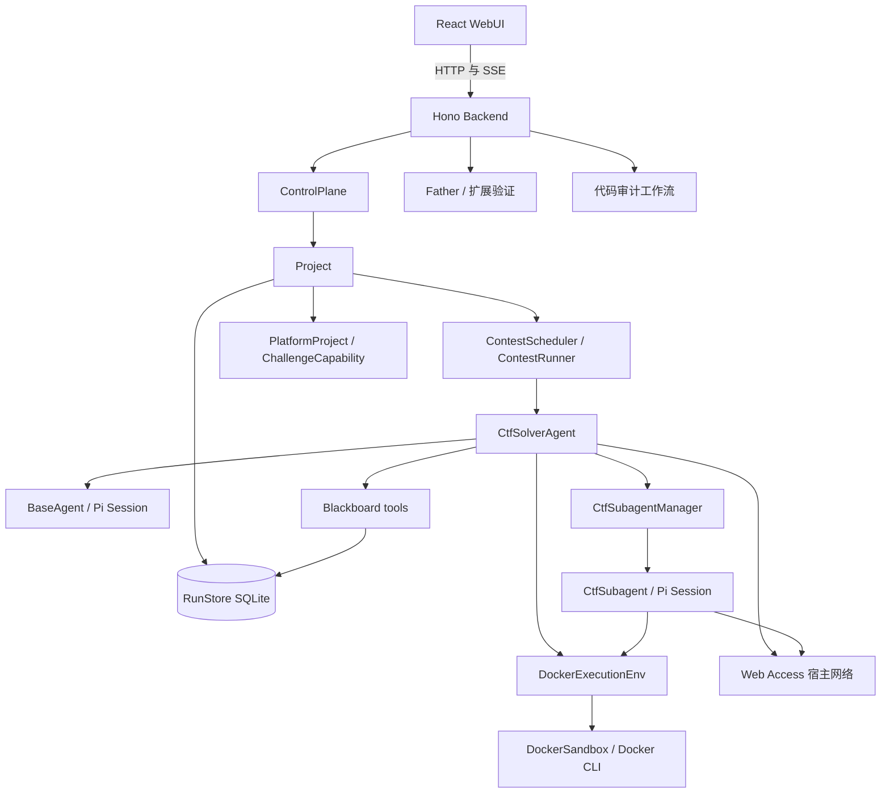
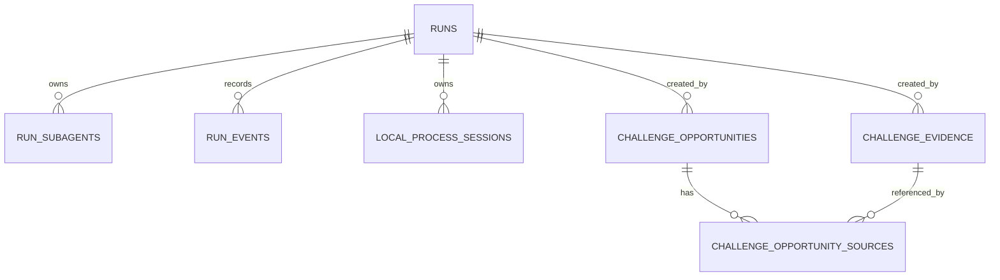
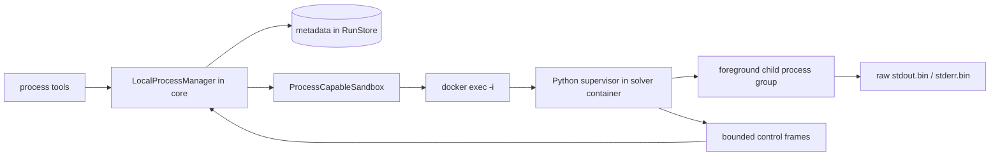
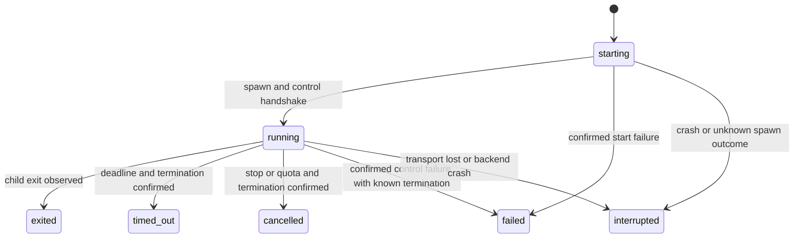

# jyff-agent CTF 二次开发设计说明书

| 项目     | 内容                                                                                     |
| -------- | ---------------------------------------------------------------------------------------- |
| 文档版本 | 1.4（2026-11-18），补记阶段 5 实验证据与 Run 资源清理的实际交付范围                      |
| 编制日期 | 2026-11-02                                                                               |
| 状态     | 阶段 0—4 工程已实现，阶段 3 效果验收受限。阶段 5 部分交付，阶段 6 未开始。               |
| 需求输入 | `jyff_agent_ctf_optimization_plan_v1.md`（不在本仓库内），以下简称“原方案”               |
| 代码基线 | `5ae3b9d56fff505dde3e3de60de089a7973eac52`；本次本地 HEAD 与其一致，核查开始时工作树干净 |
| 读者     | 后端、Agent 运行时、前端、测试、部署维护人员                                             |
| 交付边界 | 本文只交付设计，不修改业务代码，不宣称已取得解题率或成本收益                             |

**2026-11-15 维护者决策：预算仅用于测试。** 最终产品不实现费用上限、整题累计时长上限、预算耗尽停机或“限额运行”模式；撤销原 P3 预算设计及其产品入口。费用观察、Token Usage、请求/命令超时、并发和存储配额保留各自职责。阶段 4 改为持续求解与故障恢复，目标是经判题确认 accepted 或人工停止；供应商暂不可用时保留进度并暂停/恢复。测试器独立控制费用和墙钟，不向产品配置注入预算，不把截断样本计为完整失败。旧方案和阶段记录仅作历史证据，发生冲突时以本次决策为准。

快速导航：[现状架构](#sec-02) · [数据库与身份](#sec-03) · [方案审查](#sec-06) · [协作协议](#sec-07) · [迁移事务](#sec-08) · [前后端](#sec-09) · [Skills](#sec-10) · [持续求解](#sec-11) · [进程与证据](#sec-12) · [复核](#sec-13) · [开发拆分](#sec-14) · [验收评测](#sec-15) · [发布回退](#sec-16) · [Pi 升级与迁移](#sec-18)

<a id="sec-01"></a>

## 1. 设计结论与阅读指引

本项目已经具备多模型委派、异步子任务、Pi 会话、Docker 沙箱、平台适配、黑板、Skills、Web Access 和持久调度。二开应保留这些骨架，优先修复信息交接与成功结果持久化，再增加受控的执行能力。没有必要更换 Agent 框架、建设第二套任务调度器，或把现有异步协作改为所有成员必须参加的讨论会议。

原方案总体方向正确，尤其是子模型只读黑板、完整报告按需读取、按 Run 固定 Skills、复核后置于可靠生命周期。但它还不是可以直接照抄实现的设计：部分迁移、前端出口、成功语义、调用归属和文件事务边界没有落到足够具体的代码合同。

**本设计作出六项实质修订：**

1. 将“平台 accepted 不可被 writeup 或清理失败抹除”提升为首批修复。现有代码确实存在 accepted 后 writeup 校验失败而清除终态提交的路径；只新增评测指标不足以修正它。
2. 完整报告是一项跨数据库、原生 Session、工具返回、HTTP、SSE 与 UI 的联合变更。必须先建立持久化提交点和统一投影，再开放完整存储。
3. 将持续求解、持久入队与故障恢复放在本地进程生产放量之前；费用/整题时长限制只存在于独立测试工具。
4. 本地进程的幂等身份和状态采用现有 SQLite 的小型元数据表，日志仍用文件。放弃用两个 JSON 文件模拟跨文件原子事务的方案，不建设通用 Artifact 数据库。
5. 把“兼容旧客户端”“回退到旧二进制”“Run 内配置冻结”分别设计。功能开关不能自动解决这三类问题。
6. 将 Pi 升级纳入独立工作流：版本选型/兼容性调查必须完成，生产升级有条件放行。截至本次核查，0.82.1 到 1.4.0 涉及 Harness 和 Session 架构变化，不是普通依赖更新；第 7—12 章的具体 Pi API 绑定旧基线，新路线须通过第 18 章适配和验收。

建议开发人员先读第 2—6 章理解现状和决策，在实施 Pi 耦合改造前完成第 18 章选型，再按第 7—13 章的领域合同实现，用第 14—17 章拆任务、测试和发布。所有标注“现有”的能力均以本地源码核查为依据；“拟新增”“设计约定”“初始值”均不是现状。源码证据索引见附录 A。

<a id="sec-02"></a>

## 2. 现有架构与技术栈

### 2.1 总体结构



Project 是应用层数据作用域，单题 ChallengeCapability 是解题 Agent 的平台能力边界。主从 Agent 在一个 Run 内共用沙箱与题目工作区，并非彼此隔离的操作系统安全主体。Web Access 在后端宿主进程联网，不受 sandbox 的 networkMode 自动约束。[E01](#e01)[E02](#e02)[E14](#e14)

### 2.2 工具链与框架

下表记录本次仓库基线，不代表这些组件的最新版本。

| 层次       | 基线实现                                                                                                 | 开发约束                                                  |
| ---------- | -------------------------------------------------------------------------------------------------------- | --------------------------------------------------------- |
| 工作区     | pnpm 11 workspace，`apps/*`、`packages/*`                                                                | 固定 pnpm 11.20.0；使用 `vp` 命令                         |
| 构建与检查 | Vite+ 0.2.8，根 `vite.config.ts`                                                                         | 不另建独立 Vitest/Vite 配置绕过仓库入口                   |
| Node       | engines 要求 `>=22.19.0`；CI 使用 22.19.0                                                                | 后端通过 Node 的 TypeScript 转换入口运行                  |
| 类型检查   | manifest 写 `typescript ^5.9.3`；override 实际锁定 `typescript-native-bridge@6.0.3-bridge.13.tsgo.7.0.2` | 以 lock 和 workspace override 为准，不能只抄 package.json |
| Agent      | `@earendil-works/pi-agent-core`、`pi-ai`、`pi-coding-agent`，锁定 0.82.1                                 | Session API 升级必须重测执行边界、压缩和工具恢复          |
| 后端       | Hono 4.13.1、`@hono/node-server`、Zod 4.4.3                                                              | HTTP 用 Zod；Agent tool schema 现用 TypeBox               |
| 前端       | React / React DOM 19.2.8、React Router、Tailwind CSS 4、Radix UI                                         | 沿用现有路由、组件和 API client                           |
| 数据库     | Node `node:sqlite` 的 `DatabaseSync`，手写 SQL                                                           | 没有现成 ORM；同步大文本操作会阻塞后端事件循环            |
| 会话       | Pi 原生 JSONL                                                                                            | SQLite 保存业务状态，JSONL 保存会话；二者不是同一个事务   |
| 执行       | Docker CLI、DockerExecutionEnv、Python 执行辅助脚本                                                      | 现有 Sandbox 仅保证 `exec`、`close`，无可恢复 PTY         |
| 外部集成   | 平台适配器、Web Access、可选 ShellPoop                                                                   | ShellPoop 是远程 shell 服务，不等于本地进程会话           |

### 2.3 模块地图与依赖方向

| 模块                  | 主要文件/入口                                      | 现有责任                                     | 本次处理                                              |
| --------------------- | -------------------------------------------------- | -------------------------------------------- | ----------------------------------------------------- |
| `apps/backend`        | `src/main.ts`、`server.ts`、`http/app.ts`          | 启动、认证、路由、SSE、运行配置与模型配置    | 增加 DTO、分页接口、配置合并与请求归属                |
| `apps/frontend`       | `src/main.tsx`、`pages/challenge/*`                | 题目、对话、子任务、黑板、工作区、Attempts   | 报告按需展开，显示成功/总结/清理的不同状态            |
| `apps/updater`        | `src/main.ts`                                      | 准备版本、构建、切换 current、重启与失败回切 | 增加数据兼容检查；不能把代码回切当数据库回滚          |
| `packages/core`       | `control-plane/`、`project/`、`orchestration/`     | Project 装配、调度、状态、持久化             | 本次主要业务改动层                                    |
| `packages/agents`     | `base-agent/`、`solver/`、`subagent/`              | Pi 适配、工具装配、角色、Skills、会话        | reader/process 注入、报告边界辅助、压缩恢复           |
| `packages/prompts`    | `solver.ts`、`subagent.ts`、`project.ts`           | 稳定角色约束和动态上下文模板                 | 修正不真实恢复承诺，保持候选优先                      |
| `packages/sandbox`    | `docker-sandbox.ts`、`docker-execution-env.ts`     | Docker 生命周期、命令、文件与输出            | 可选 attached pipes 能力、进程监督传输                |
| `packages/platform`   | `index.ts`、`registry.ts`、各平台实现              | CTFd、DASCTF、GZCTF、Ret2Shell 统一契约      | 复用；补可选接受时间只能通过契约，不散落平台特判      |
| `packages/web-access` | `src/*`、`UPSTREAM_PIN.md`                         | 搜索、来源检查、内容提取                     | 不重写 fork；保留用量观察与宿主网络边界               |
| `packages/shellpoop`  | `src/index.ts`                                     | 远程 shell 会话                              | 不受本地进程工具替换，保留既有清理                    |
| Father / 扩展         | `core/src/father/`、`extensions/`                  | 插件作者会话、验证、激活                     | 回归保护；不注入 CTF 角色选择或求解策略               |
| 代码审计 / TLDR       | `core/src/code-audit/`、`agents/src/tldr-agent.ts` | 独立审计、题目摘要                           | 审计不套用 CTF 协议；由求解触发的 TLDR 需明确调用归属 |

保持 `core → agents → sandbox/platform/prompts` 的依赖方向。core 将 reader、进程能力和请求生命周期 hook 作为窄接口传给 agents；禁止 agents 导入 core 的 Manager/RunStore 形成循环。暂不创建通用工作流包或共享协议平台：先在现有导出面定义 DTO 和纯函数，确有跨应用运行时复用时再提取。

<a id="sec-03"></a>

## 3. 持久化、身份与部署现状

### 3.1 文件和数据根目录

```text
<root>/
├── .pi/skills/                             # 默认发现来源，多个 Project 可共享
└── .ctf-agent/
    ├── project-registry.json
    ├── secrets.json / auth.json / model-config.json ...
    ├── runtime-config.json / runs.sqlite   # 根 Project
    ├── projects/<hash(projectId)>/         # 其他 Project 的状态目录
    │   ├── runtime-config.json / runs.sqlite
    │   ├── runs/<runId>/session.jsonl
    │   └── challenges/<challengeKey>/workspace/
    ├── father/sessions/
    └── extensions/<pluginId>/revisions/
```

运行目录与源码目录分离。标准 Compose 的 root 为 `/data`，状态卷挂在 `/data/.ctf-agent`，并挂载 Docker socket。Skills 默认应另提供到 `/data/.pi/skills`。`runDirectory` 独立于题目工作区：**相同 challenge 的多次 Run 会复用 workspace，不能把 runId 当作文件隔离保证。** 不在本文或评测清单中复制 `secrets.json` 的内容。[E02](#e02)[E08](#e08)

### 3.2 主要数据库表

RunStore 打开 SQLite 时启用 WAL、`synchronous=FULL`、外键和 5000 ms busy timeout。业务迁移目前采用 `CREATE TABLE IF NOT EXISTS` 与 `PRAGMA table_info` 检查后加列；没有完整迁移框架。[E03](#e03)

| 表                                                  | 核心身份/关系                        | 内容及二开影响                                       |
| --------------------------------------------------- | ------------------------------------ | ---------------------------------------------------- |
| `runs`                                              | `id`；`(challenge_id, attempt)` 唯一 | 生命周期；需增加成功事实和持久恢复关联               |
| `run_events`                                        | 自增 ID，FK `run_id`                 | 顺序事件；适合关键状态审计，不适合逐字节日志         |
| `run_subagents`                                     | `id` 主键，FK `run_id`               | 当前子会话状态、result、usage；无执行版本历史        |
| `model_token_usage`                                 | provider/model/source/source_id      | 展示统计；仅作观察，不参与停止决策；未知费用不当作零 |
| `challenge_evidence`                                | 自增 ID、challenge_id、creator run   | 同题跨 Run 记录，可修改；不是自动验证的事实库        |
| `challenge_opportunities`                           | 自增 ID、challenge_id、creator run   | open/concluded，confirmed/dead_end 结论              |
| `challenge_opportunity_sources`                     | opportunity/evidence 复合键          | 黑板关系表                                           |
| `challenge_runtime_state`、`challenge_block_events` | challenge_id                         | 阻塞评分、恢复和诊断                                 |
| `scheduler_queue`、`scheduler_control`              | 持久队列、版本与模式                 | 需补 retry 持久化与目标恢复路径                      |
| `challenge_scheduling_overrides`                    | challenge_id                         | 人工 solved/excluded，与本次评测 accepted 分开       |
| `platform_view_cache`                               | 平台缓存身份                         | 平台状态快照，不是本次求解结果证明                   |
| `remote_environment_leases`                         | 租约身份、challenge_id               | 实例容量、恢复、补偿清理                             |
| 公告相关表、`challenge_tldr`                        | 公告/题目/Run 关系                   | 维持现状；求解期间模型调用应记录对应 Run/用途        |

黑板现有限制为描述 4000 个 JavaScript UTF-16 code unit、每条最多 32 个来源、每题两类分别最多 256 条。新的输出分页按 Unicode 码点和序列化字节计算；本期不顺带改变已有写入长度合同。

### 3.3 身份模型

| 身份                      | 生命周期                     | 不可混同的对象                             |
| ------------------------- | ---------------------------- | ------------------------------------------ |
| projectId                 | 一个比赛/项目                | 不能由工具调用参数任意覆盖闭包绑定         |
| challengeId               | 平台题目                     | 多个 Run 可共享题目黑板与 workspace        |
| runId                     | 一次尝试/可恢复运行          | 已有恢复可能沿用同一 Run，不总是新建       |
| subagentId                | 可 resume 的子会话           | 不是一次执行身份                           |
| executionId（新增）       | spawn/每次 resume 各生成新值 | 相同报告文本也属于不同执行                 |
| 求解目标身份（P3 待冻结） | 一次明确求解目标             | retry/resume 保留状态，不关联费用/时长上限 |
| processSessionId（新增）  | 一次受管进程启动             | 与 Pi session、远程 ShellPoop ID 分开      |
| artifactRef（新增）       | Run 内文件或固定前缀的引用   | 路径不等于不可变内容，必须含完整性信息     |

### 3.4 恢复能力的真实边界

当前启动会将遗留 preparing/running Run 和活动子任务标为 interrupted，并尝试清理带标签容器；这不等于恢复进程内存。Pi JSONL 恢复会话也不证明附件、目标实例或 Skills 文件仍与上次相同。新增本地进程必须额外检查所有 cleanup 未确认的记录，不能仅复用 `markInterruptedRuns()` 的返回集合，因为 writing_writeup、失败或已结束 Run 仍可能有未清理资源。

<a id="sec-04"></a>

## 4. 现有工作流与需要保持的行为

### 4.1 启动到求解

1. Backend 读取全局配置、凭据、模型池、平台插件和 Project 注册表，创建 ControlPlane。
2. Project 连接平台、打开 RunStore、发现 Skills/roles，恢复本地状态并协调遗留实例与沙箱。
3. WebUI 通过 project-scoped HTTP 调度题目；ContestScheduler 维护持久 idle/execution 队列，ContestRunner 提供批量运行路径。
4. `Project.createSolver()` 取得/创建 Run、题目 workspace、session 路径，创建沙箱、SubagentManager 和 Solver。
5. Solver 使用平台工具、bash/文件工具、黑板、Web Access；按需调用 `Agent`，子任务独立执行并通过结果、通知和 steer/resume 回交。
6. 候选由主 Solver 核验并调用 `ctf_submit_flag`。主模型独占提交；子模型不新增递归委派或写黑板。
7. accepted 后按运行模式关闭或进入 writeup；最后回收子任务、远程实例、ShellPoop 与 Docker。

### 4.2 源码揭示的实际缺口

| 缺口                      | 当前行为                                                  | 后果                                             |
| ------------------------- | --------------------------------------------------------- | ------------------------------------------------ |
| 黑板尾部不可达            | `blackboard_read {}` 返回截断文本，details 仍携带 summary | 模型无法定点取回完整条目，隐藏详情还可能扩大载荷 |
| 报告采集复用 UI helper    | `extractAssistantText` 默认 8000 字符                     | 存储前已丢尾部，后续接口无法补回                 |
| resume 没有执行隔离       | 原记录清空后继续；无 executionId/CAS                      | 迟到旧回调可能污染当前执行                       |
| 状态保存属于遥测旁路      | onRecord 不等待；Project 捕获异常仅记 diagnostic          | 收到完成通知不等于报告已可靠保存                 |
| 子模型压缩承诺不成立      | 使用主 Solver 的 compaction prompt                        | 摘要可能丢弃子模型无法由控制面补回的事实         |
| Skills 路径可覆盖         | 全量注入并复制到固定 `.skills/skill-N`                    | 同题下一 Run 可能改写上次引用                    |
| 一次性执行无持续 stdin    | Docker 执行器立即结束输入                                 | 用 exec 外包一个 ID 不能实现交互进程             |
| 报告在多个出口展开        | ChallengeDetails、steer/cancel 等直接携带 record          | 完整存储会放大 HTTP、SSE/UI 和模型上下文负担     |
| accepted 与 writeup 耦合  | writeup 失败可能清除 finalSubmission                      | 已解结果可能被统计为失败或重复调度               |
| 当前 timeout 不是整题墙钟 | 每轮 prompt 设置超时，环境等待可暂停计时                  | 多轮/重试可突破原方案定义的整题时间              |

以上问题对应 [E04](#e04)—[E13](#e13)，不是对模型解题能力的猜测。

<a id="sec-05"></a>

## 5. 需求、范围与非功能合同

### 5.1 需求追踪

| ID  | 可开发需求                                     | 原方案章节      | 本设计实现章节 | 交付阶段                |
| --- | ---------------------------------------------- | --------------- | -------------- | ----------------------- |
| D01 | accepted 成功事实独立持久化，不被总结/清理覆盖 | 1、3、8、13、14 | 7.1、8.1       | P0                      |
| D02 | 子模型真实可恢复的压缩规则                     | 6               | 7.4            | P0                      |
| D03 | 主写子读、黑板定点/分页/变更检测               | 4               | 7.2            | P1                      |
| D04 | 当前执行完整报告、版本化分页、所有自动出口有界 | 5               | 7.3、8、9      | P1                      |
| D05 | Run 冻结配置、旧客户端省略不清值               | 7、11           | 7.5、9.3       | P1/P2                   |
| D06 | Skills 按角色选择并冻结包版本                  | 7               | 10             | P2                      |
| D07 | 持续求解、持久重试与请求恢复                   | 原预算方案撤销  | 11             | P3（修订后）            |
| D08 | 本地 pipes 长进程、幂等、输入、输出、清理      | 8               | 12             | P4                      |
| D09 | 实验记录、文件引用和真正范围读取               | 9               | 12.5           | P4                      |
| D10 | 有条件、有限额的复核和重新规划                 | 10              | 13             | P5                      |
| D11 | 同预算、隔离环境、包含失败的评测               | 13              | 15             | 全阶段                  |
| D12 | 有界兼容版本、备份和可执行回退                 | 11、14          | 16             | 全阶段                  |
| D13 | Pi 版本选型、适配边界、会话兼容和独立升级验收  | 本次补充        | 18             | U0 必做；U1—U3 条件实施 |

### 5.2 可由工程保证的边界

- 权限：查询只在当前 Project/challenge/Run 作用域内；子模型没有黑板写 API、提交 API 或递归派发 API。
- 完整性：已成功保存的当前报告可以有限次分页精确重组；缺失或变化必须显式报错。
- 有界性：度量实际序列化后的 AgentToolResult/HTTP DTO 字节数，包含封套和 details；字符数不等于 Token 数。
- 生命周期：重试不丢失目标状态，终态发布不早于数据库提交，过期执行不能覆盖新执行。
- 可恢复性：缺少 marker、manifest、日志或调用归属时显式诊断，不能自动换最新文件或拼接旧报告掩盖缺失。
- 成功路径：候选不等待全员；accepted 与 writeup/cleanup 独立，截止后的 accepted 仍是实际平台事实，但不算严格评测的按时成功。

不能由 schema/hash 保证：证据真实性、自然语言推理正确、不同模型没有锚定、复核一定改善解题率、共享 workspace 内的 OS 级隔离。评测必须区分工程合同和策略收益。

### 5.3 首版明确不做

不更换 Pi 技术生态；首批正确性修复可保留当前 Harness，新版运行时迁移独立按第 18 章推进。不增加第二个比赛/子任务业务调度器，不建设多人可写黑板，不复制完整思考到共享报告，不建设 Skills 市场或自动安装依赖，不新增通用 MCP 平台，不承诺跨重启恢复 stdin/PTY，不把全部外部工具一次性重做成专用接口。固定“每题三名子模型且全部最高思考档位”不作为产品默认；并行人数应由任务可分解性和资源并发能力决定。

<a id="sec-06"></a>

## 6. 对原方案的审查与取舍

| 编号/优先级 | 审查意见                                 | 依据与可能的负面效果                                                                      | 本设计决策                                                                                    |
| ----------- | ---------------------------------------- | ----------------------------------------------------------------------------------------- | --------------------------------------------------------------------------------------------- |
| A01 / P0    | 优化目标正确，但当前成功口径不可靠       | accepted 后 writeup 失败会清终态；无法用失真的 A 组判断 B 组收益                          | 先分离 solveOutcome、writeupStatus、cleanupError；基线同时重算原始 accepted 事件可确认部分    |
| A02 / P0    | “只加 execution_id/result_kind”不够      | fire-and-forget + 无 CAS 整行 upsert 仍能覆盖新报告                                       | 独立关键提交 API；进度更新不允许写报告列；旧执行 CAS 拒绝                                     |
| A03 / P0    | 全文存储不能单独上线                     | UI 快照会反复抓所有历史子报告；关闭开关也不删除已存全文                                   | 全出口投影与单报告读取必须同批交付；回退保留有界读取                                          |
| A04 / P1    | 无参 reader 语义有隐性回退               | 旧调用拿两类全板，新调用默认只有 evidence 索引；机会可能被忽略                            | prompt 与恢复快照显式携带两类计数/入口，UI 识别 schemaVersion，不称结构兼容                   |
| A05 / P1    | 全板可读可能增加错误结论传播             | 共享结论会使路线趋同，主写子读也不能证明事实                                              | 索引默认，按任务读 ID；条件化记录；保留污染专项，收益不达标就少共享                           |
| A06 / P1    | 定向复核容易成为高成本重复探索           | 名为 review 不等于独立验证；全板可读更不等于盲评                                          | 必须列决策问题、可区分实验、新证据与限额；先对照再开启                                        |
| A07 / P1    | 测试限制与产品目标混淆                   | 同等评测条件不能成为产品停机机制                                                          | 独立评测器控制费用/墙钟；产品持续求解与恢复                                                   |
| A08 / P1    | 两个 JSON 原子 rename 不构成联合事务     | request 文件和 session 文件之间崩溃，可重复启动或丢句柄                                   | 用 SQLite 唯一键原子保留请求与状态；文件仅日志/导出                                           |
| A09 / P1    | Skills 包 hash 不等于环境复现            | 工具二进制、镜像、依赖、远端实例仍可能变化                                                | manifest 另记录镜像 digest/附件 hash/实际模型等可获得环境信息；未知明确标记                   |
| A10 / P1    | 主写黑板可能成为串行瓶颈                 | 所有观察都要求主模型转录会消耗推理预算                                                    | 子任务直接交报告和引用，只将影响后续决策的观察入板；首版不加自动总结模型                      |
| A11 / P1    | 没有历史报告表是合理简化，但必须承认代价 | resume 会替换旧 result；resultVersion 不是历史检索键                                      | 首版仅当前报告可查，旧引用返回 changed；需要复用时先固化所需证据，历史归档后续按需做          |
| A12 / P2    | 1200 码点乘 16 条不保证小于 16 KiB       | 中文、emoji、JSON 转义和任务说明会超预算                                                  | 连续前缀装页；单条最小元数据必须可装；列表默认数只是上限                                      |
| A13 / P2    | 进程工具会增加大量生命周期成本           | stdin、双流、EOF、超时、重启、配额均是实际新能力                                          | 先 pipes 能力样例；普通批处理继续 bash；不提前承诺 PTY                                        |
| A14 / P2    | “可回退”被低估                           | updater 回切代码不自动恢复 SQLite；旧版可展开新长报告                                     | 记录数据能力版本、维护兼容回退构建；完整旧版回退必须恢复一致备份                              |
| A15 / P2    | 所有数值都冻结为默认容易过拟合开发题     | 8 KiB/64 KiB、会话数、复核次数并非已测最优值                                              | 初始值用于合同测试和容量控制，性能阈值由开发集定、验收集验证                                  |
| A16 / P1    | “升级最新版底座”并非低成本修补           | 0.84 已换 Session，1.x 已移除本项目使用的 core Harness 出口；迁移还涉及私有 HTML 导出接缝 | U0 必须先选路线；U1 单独迁移，不与协作/恢复策略同时上线，不把新版发布说明当项目自动获得的能力 |

这些修订不否定原方案，主要把“良好的协作设想”落实为可恢复、可兼容、可验证的工程边界。最应避免的负面优化，是增加更多 Agent、工具和摘要后，系统花更多时间维护自身状态，却没有更快得到平台 accepted。

<a id="sec-07"></a>

## 7. 核心协作详细设计

### 7.1 accepted、writeup 与清理解耦

新增独立 `solveOutcome`：`accepted | already_solved | legacy_success | null`。`already_solved` 仅表示平台报告已解，不自动算本次隔离实验成功。旧 `status=solved` 迁移为 `legacy_success`，不猜测接受时间。`writeupStatus` 为 `not_requested | pending | running | validated | failed | interrupted | legacy_unknown`；旧状态无法确认时使用 legacy_unknown，新 Run 才使用 not_requested。清理继续使用独立错误字段。

`Run.status` 暂保留旧生命周期枚举，避免一次更改所有 API；但新版统计、已解过滤与重试判定必须优先使用 solveOutcome，不能依赖 status 是否 solved。处于 writing_writeup 的 Run 仍占既有活跃沙箱槽；accepted 后立即终止探索子任务和受管实验，保留供 read/write/edit/list 完成总结所需的容器，最终再关闭。

```mermaid
sequenceDiagram
  participant S as Solver
  participant T as submit tool
  participant P as Platform
  participant R as Project / RunStore
  participant C as Cleanup / Writeup
  S->>T: ctf_submit_flag(candidate)
  T->>P: submit
  P-->>T: accepted
  T->>R: await recordSolveOutcome(receivedAt, response)
  R->>R: transaction: outcome + accepted event
  R-->>T: committed
  T-->>S: accepted + terminate
  R->>C: stop exploration; bounded cleanup
  C->>C: optional writeup with restricted tools
  C->>R: writeupStatus / cleanupError
```

具体变更：提交工具的终态回调改为可等待 Promise；Project 注入可靠保存 hook；Solver 的 `discardTerminalSubmissionForWriteupFailure()` 不再承担抹除成功的作用；Scheduler/Runner 的 catch/finally 根据已保存 outcome 汇总结果。平台响应和 SQLite 无法组成分布式事务：响应已 accepted 但保存失败时，停止新探索并返回 `accepted_persistence_failed`，保留可取得的原始回执/Session 诊断，**不以普通提交失败提示模型再提交**。重启后需平台状态和本地证据 reconcile；没有证据时标未知，不承诺绝对无丢失。

`observedAcceptedAt` 在宿主收到 accepted 响应时取得，`platformAcceptedAt` 仅在平台契约确有可靠字段时写入。already_solved 单独保存观察事件，不填造本次 observedAcceptedAt；重复回执不改写首次接受时间，也不将 accepted 降级为 already_solved。达到截止后收到 accepted 仍保存，但严格评测标 `acceptedLate=true`。工具超时、网络断开、候选正则命中均不等于平台 accepted。

### 7.2 黑板 Reader V2

**装配与权限。** 从 `createBlackboardTools()` 提取 reader 工厂。Project 将绑定 challengeId/RunStore 的 reader 能力传给 Manager，再传给 CtfSubagent。工具参数不接受 projectId/challengeId。主模型仍拥有 read/record/manage；子模型只增加 read。开启协作 reader 时检查参与的自定义 `role.tools` 是否显式允许它；未配置 tools 的内置角色按现有默认集合工作，禁止偷偷扩大显式白名单。

**输入合同。** 下列均是拟新增的 V2 合同：

```ts
type BlackboardReadInput = {
  kind?: "evidence" | "opportunity" // default evidence
  view?: "index" | "full" // default index
  ids?: number[] // 1..16 safe positive integers
  afterId?: number // safe integer >= 0
  limit?: number // default 8; 1..16
}
```

`ids` 与显式 `afterId/limit` 互斥，校验需区分“未提供”与应用默认值。IDs 去重并保留请求顺序；分页始终按当前 kind 的 ID 升序，不能跨类型混用游标。`{}` 仍有效，但只返回 evidence 索引第一页，因此是调用兼容而非语义/返回结构兼容。

**返回合同。** `schemaVersion=2`，包括 kind/view/readAt/entries/missingIds/omittedIds/hasMore/nextAfterId。index 条目提供 id、creatorRunId、createdAt、状态（仅适用类型）、contentHash、preview、previewComplete；preview 最多 160 码点。full 保留完整描述与关系字段，不从描述中截一半。无对应记录时 missing；本题外 ID 与不存在 ID 的处理完全相同。

| 场景       | 必须行为                                                                                                   |
| ---------- | ---------------------------------------------------------------------------------------------------------- |
| 普通分页   | SQL 带 challenge_id 和 `id > afterId`；连续前缀装页；nextAfterId 仅在有后续时等于本页最后返回 ID           |
| ID 查询    | missingIds 区分不存在，omittedIds 区分本页放不下；后者非空则 hasMore=true，下次按 omittedIds 续查          |
| 输出字节   | index 8 KiB、full 64 KiB 初始上限；测量整个工具返回对象，details 不复制正文                                |
| 单条超限   | 启动校验保证所有合法 full 单条可装；遇到历史非法大条目返回 `entry_too_large`，给出 ID 和诊断，不能空页循环 |
| 内容变化   | 每次读当前数据库，不承诺跨页快照；依赖关键结论前按 ID 重读 hash                                            |
| 来源与时间 | creatorRunId/createdAt 来自记录列；readAt 不是修改时间；缺少的来源字段不可从描述猜测                       |

新增 RunStore 查询方法直接选择字段与关联，不在 `getBlackboardSummary()` 全表结果上切片冒充分页。机会列表可增加 `(challenge_id, id)` 索引，保留现有状态索引。每页返回 `counts` 或有界导航元数据，提醒机会列表存在；压缩恢复只给短索引/引用，不重新注入全量正文。

hash 使用显式版本的固定字段序列，例如 `sha256(JSON.stringify([1, kind, id, description, statusOrNull, resolutionOrNull, sortedSourceIds, targetIdOrNull]))`；不做 Unicode normalization，不混入 readAt。字段域改变必须升 hashVersion。hash 只检测记录内容变化，环境变化还需附件 hash、实例身份等独立条件。

写入描述建议固定为“观察、条件、来源、解释、否定范围”；本期保持既有写工具与状态枚举。展示标题改为“已记录的证据与观察”。子任务报告并不自动入板，重复转述同一原始依据不算多个独立来源。

### 7.3 完整报告与执行版本

**模块拆分。** `agents/src/subagent/session-report.ts` 只负责读取原生 Session 中本次执行的文本；`core/src/collaboration/subagent-report.ts` 负责版本与分页；`subagent-projection.ts` 负责各种有界投影；Manager 负责生命周期。它们不复用 UI 的文本截断函数。

拟新增持久化接口如下，实际签名可按仓库类型组织，但语义必须保持：

```ts
interface SubagentPersistence {
  beginExecution(input: BeginExecution): Promise<CommittedSubagent>
  commitResult(input: ResultCommit): Promise<CommittedSubagent>
  recordProgress(input: ExecutionProgress): Promise<void>
}
// BeginExecution: runId/id/previousExecutionId/newExecutionId/status/prompt
// ResultCommit: runId/id/executionId/status/result/resultKind/error/completedAt
// ExecutionProgress: 身份 + turns/toolUses/usage/activeTool，不含 result 列
```

spawn 和 resume 必须先提交新 executionId、清空旧结果和终态字段，再启动。resume 仅允许既有可恢复状态，仍沿用原并发控制，不并行运行同一子会话两次。完成回调、进度回调与内存对象均捕获 executionId；旧执行既不能改数据库，也不能提前修改共享内存中的新记录。

```mermaid
sequenceDiagram
  participant M as SubagentManager
  participant D as RunStore
  participant P as Pi Session
  participant A as Child Agent
  M->>D: beginExecution(oldId, newId)
  D-->>M: durable new execution
  M->>P: appendCustomEntry(execution marker)
  P-->>M: appended
  M->>A: launch / resume
  A-->>M: execution ended
  M->>P: freeze leaf; walk raw parent chain
  P-->>M: selected text + resultKind
  M->>D: CAS commitResult(newId)
  D-->>M: committed
  M-->>M: resolve waiters and notify parent
```

**执行边界。** marker 类型为 `ctf_subagent_execution`，仅含 executionId 等有界宿主元数据，不注册模型上下文 projector。读取时冻结 leafId，使用 `getEntry(id).parentId` 追到匹配 marker，检测循环、缺父节点与缺 marker；禁止用 `getMessages()`、数组下标、`getBranch()` 或全历史倒扫作替代。压缩 summary/retainedTail 的副本不能当作本次原始消息。

已对官方锁定 Pi 0.82.1 包做静态核验，包完整性与 lock 一致，相关 API 存在，getBranch 路径确会在 compaction 处截断；这证明设计有 API 基础，不代表跨压缩集成测试已通过。[E15](#e15)

此处 appendCustomEntry/getEntry/parentId 是 **0.82.1 适配方式**，并非跨版本公共保证。选择新运行时时必须重新实现“非模型可见的执行边界、当前执行原始记录、完整 text-only 报告”的等价领域合同；不能把旧算法直接移到不同 Session 模型，或用压缩后上下文凑成兼容。

**文本选择。** 正常完成选择本次执行最后一条可用 assistant 消息的 text 块，保留全文；失败/取消/胜者收尾按本次原始消息时间顺序选择最近可用 assistant 或工具文本。分别标 `assistant_final / assistant_partial / tool_partial / legacy`；final 只代表报告来源与执行状态，不代表内容已验证。排除 thinking、自定义 marker、压缩摘要。没有合法报告返回 unavailable；不能捞前次执行文字填空。必须检查 Pi 返回的 stopReason：error/aborted/timeout/cancel 均按对应终态和 partial 处理，不能把 Promise 未 throw 当成正常完成；当前 Manager 忽略 prompt 返回值的路径也要修正。

**存储。** 正文仍存 `run_subagents.result`。本设计建议首个工程试验的 `maxStoredReportBytes=4 MiB`，这是新增容量初值，需基线分布校准；超过返回 `report_storage_limit`，保留 Session 引用供授权维护界面定位，不截尾伪称完整。数据库写失败不能发布完成报告。进度更新不得每次重写全文；resultVersion/码点长度可按 execution 缓存，重启可重建，缓存不是权威数据。

**按需读取。** 保留 `agent_id/wait/interrupt_on_steer`，增加 offset/limit/expectedResultVersion。offset 按 Unicode 码点、默认 0；limit 默认且最大 8000。版本由固定规范化字段 `[schema, runId, subagentId, executionId或legacy域, kind, 正文]` 的 hash 形成。updatedAt 不参与。单次从同一不可变记录快照计算页、版本和长度。

```json
{
  "schemaVersion": 2,
  "agentId": "child-id",
  "executionId": "execution-id",
  "status": "completed",
  "resultKind": "assistant_final",
  "resultVersion": "v1:<sha256>",
  "offset": 0,
  "result": "本页文本",
  "totalLength": 12345,
  "nextOffset": 8000,
  "hasMore": true
}
```

上例的 result 为示意文本，实际 offset/totalLength/nextOffset 由真实正文计算。offset>0 必须给 expectedResultVersion；首屏允许携带版本检查。优先检查版本失效，即使 resume 后新报告暂为空也返回 changed。offset=总长返回空尾页；超出报 invalid_offset。wait 绑定开始时 executionId，等待期间执行变化报 execution_changed。活动无报告为 result_pending；终态无报告为 result_unavailable。

**所有自动出口。** 单任务的 Agent 前台完成、resume、get 首屏、完成通知、steer/cancel 返回保留最多 8000 码点，封套最多 96 KiB；保证旧 8000 UTF-16 字符前缀不被缩短。列表、快照、blocked 收尾每项最多 1200 码点，整个子任务列表最多 16 KiB。任务说明、error、工具状态等另行限长，优先缩短这些字段而非承诺的正文首屏。details 只保留 ID、状态、版本、翻页等有界元数据。

`list_subagents` 增 cursor/limit，默认 16、最大 32，按不可变 `(createdAt,id)` 升序；cursor 编码并绑定 runId，必须校验结构和范围。仅装连续前缀，使用字节预算后实际条数可小于 limit；省略项用 omittedCount 和 nextCursor 可枚举发现。首条最低限度元数据必须能装，避免空页死循环。API 子列表与恢复快照复用相同投影，不把所有历史 Run 的列表拼接后再称“16 KiB 总限制”。

**崩溃窗口。** DB begin 成功但 marker 失败：本次 failed/interrupted，无报告；marker 成功但未运行：恢复 interrupted；报告已提交但通知失败：按需读取仍有效，通知可按 executionId/resultVersion 去重补发。保存失败让前台和 wait 调用收到 `report_persistence_failed`，冻结该执行的复用并停止工作，不能永久等待或虚构已持久化 failed 状态。重试保存只针对同一 executionId 的已捕获快照，并经 CAS 校验。SQLite 与 JSONL 不做伪原子承诺。旧记录 executionId 为空、resultKind=legacy，完整性未知，不扫描历史补造全文。

### 7.4 压缩与权限恢复

新增 `SUBAGENT_COMPACTION_PROMPT`，保留任务、实验条件、依赖证据 ID/hash、尚未交接观察、日志引用、当前进程状态、下一步。未启用 reader 的角色必须保留具体必要事实；启用 reader 也不能只保留无法还原环境的 ID。主 Solver 保持其现有快照恢复路径，但输入改为有界投影。

恢复工具集合按 `旧 activeToolNames ∩ 当前角色合法集合 ∩ 当前阶段合法集合` 计算，再仅在当前配置允许时补 reader。通过现有 `setActiveTools` 持久化；writeup 阶段只能 read/write/edit/list，不因会话迁移重新获得提交、进程或黑板写权限。role.tools 只是 API 白名单，不是共享文件权限隔离。

### 7.5 Run 配置冻结

新增 `run-config-snapshot.ts`，在创建 Agent 前固化 optimization、skills 有效选择、角色 prompt/tool 白名单、模型 ID/实际支持的思考档位、相关输出与资源上限。保存不含密钥的 `configHash` 与快照路径，并写 `run_configuration_frozen` 事件。运行中更改 Project 配置仅作用于新 Run；紧急取消仍可停止旧 Run，不能用静默换协议代替停止。

快照另保存 runtimeProfile：实际 Pi 包版本、完整 lock hash、适配器 ID、Session 格式/迁移版本及已验证能力集合。恢复必须匹配可读取该格式的适配器；不得在同一个 Run 中途静默切换底座。旧记录未保存这些字段时标 unknown，不能从当前安装版本推断历史版本。

恢复沿用原快照。旧 Run 没快照时标 `legacy-resume`，注明历史配置未知；默认按兼容模式恢复，不能自动重置目标状态或声称已证明环境复现性。Provider 凭据可轮换，凭据内容不入快照；模型配置中可观测端点/模型/能力发生变化应有诊断，不能声称与旧运行完全相同。

<a id="sec-08"></a>

## 8. 数据模型、事务与迁移

### 8.1 分阶段数据库变更

以下是开发 DDL 规格，需沿既有 `PRAGMA table_info` 机制写幂等迁移；不可直接重复执行 ALTER，也不可删表重建生产数据。

| 阶段 | 变更                         | 字段/约束                                                                                                                                                                               |
| ---- | ---------------------------- | --------------------------------------------------------------------------------------------------------------------------------------------------------------------------------------- |
| P0   | `runs` 加列                  | `solve_outcome TEXT NULL`、`observed_accepted_at TEXT NULL`、`platform_accepted_at TEXT NULL`、`writeup_status TEXT NOT NULL DEFAULT 'legacy_unknown'`；新 Run 创建显式写 not_requested |
| P0   | 数据能力登记                 | 新 `runtime_data_capabilities(name PRIMARY KEY, version INTEGER)`，如 accepted-fact-v1、bounded-report-v2；供受控启动/回退检查                                                          |
| P1   | `run_subagents` 加列         | `execution_id TEXT NULL`、`result_kind TEXT NULL`；旧非空 result 标 legacy                                                                                                              |
| P1   | 黑板查询索引                 | `challenge_opportunities(challenge_id,id)`，按查询计划确认有必要后加入                                                                                                                  |
| P3   | 队列/Run 恢复关联            | solve_goals 与 resume_run_id/retry_prompt/writeup_retry/requires_auto；DDL 已在阶段 4 冻结，见第 11.3 节；不建预算表                                                                    |
| P4   | 新 `local_process_sessions`  | 请求幂等、身份、状态、截止、日志位置/长度、清理状态；不存原始输出块                                                                                                                     |
| P5   | `run_subagents` 加协作记账列 | `purpose TEXT NULL`、`review_id TEXT NULL`；旧记录 NULL 表示历史分类未知，新任务使用 explore/verify/review                                                                              |

solveOutcome 的数据库 CHECK 允许第 7.1 节枚举，NULL 表示无可确认成功事实；writeupStatus/resultKind 同样校验。新增 nullable 外键按 SQLite 能力实施，并测试旧库升级；不满足直接 ALTER 的约束使用明确迁移步骤，而非仅在 TypeScript 类型里声称外键存在。最低读取能力登记不能阻止完全不认识它的旧二进制，因此还必须有第 16 章的发布约束。

### 8.2 新投影的字段规格

| 表                       | 必需字段                                                                                                                                                                                                                                                                                    | 唯一性/索引                                                                      |
| ------------------------ | ------------------------------------------------------------------------------------------------------------------------------------------------------------------------------------------------------------------------------------------------------------------------------------------- | -------------------------------------------------------------------------------- |
| `local_process_sessions` | id、run_id、owner_agent_id、execution_id、request_key_hash、fingerprint、state、command_ref、cwd、mode、created_at、started_at、deadline_at、exit_code、stop_reason、stop_requested_at、cleanup_state、cleanup_error、stdout_path/stderr_path、stdout_bytes/stderr_bytes、final_hashes_json | PK id；UNIQUE(run_id,owner_agent_id,request_key_hash)；run/state 与 cleanup 索引 |

command_ref 指向受管理的启动描述文件，避免把长命令反复嵌入状态响应；其文件发布成功后才提交可启动记录，失败即不启动。其删除跟随 Run 保留策略。owner 由宿主绑定为 `solver` 或子会话 ID，executionId 用于来源追踪，不使 resume 取得新的 requestKey 命名空间。主模型接手仍保留原 owner 审计。

目标恢复状态已在阶段 4 冻结为 active/paused/stopped/accepted；不设置 exhausted 或费用状态。旧预算表设计已撤销，不执行对应 DDL。



图中黑板关联 Run 表示创建来源；查询范围仍是 challenge，不应误读成仅当前 Run 可见。

### 8.3 关键事务

| 操作               | 同事务内的动作                                                          | 提交后才允许                      |
| ------------------ | ----------------------------------------------------------------------- | --------------------------------- |
| recordSolveOutcome | 首次成功事实/时间 + 有界 accepted 事件；幂等保留首次观察                | 发布 accepted 终态与成功通知      |
| beginExecution     | 校验旧执行与可恢复状态；更新新 ID，清正文/error/completedAt；写开始事件 | append marker、排队/启动          |
| commitResult       | 按 executionId CAS 写正文/kind/status；写不含正文的完成事件             | resolve waiters、父通知、SSE 状态 |
| reserveProcess     | 校验幂等键、归属、活跃资源配额与目标取消状态，插入 starting             | 启动容器内监督进程                |

报告提交 SQL 必须含 `WHERE run_id=? AND id=? AND execution_id=?`，并限定允许的非终态前态。不同执行不匹配返回 stale_execution；同一执行的 cancel/正常完成竞争时首次终态提交胜出，重复完成幂等返回已保存结果，不覆盖。recordProgress 同样仅更新非终态且不触碰 result/终态字段。beginExecution 同时检查可恢复状态与旧 executionId，legacy NULL 使用 IS NULL。任何 CAS 失败不得降级无条件 upsert。BEGIN/COMMIT 区间内不能等待网络或运行模型；Node 单进程 keyed lock 解决本地异步交错，SQLite 条件更新是持久层兜底。首版仍按现有单后端实例部署，不声称仅靠 keyed lock 支持多个后端同时调度同一数据目录。

### 8.4 迁移与恢复规则

1. 停止写入并取得一致备份；使用 SQLite backup 或停服务后连同 WAL 状态正确处理，不能在线只复制主 DB 文件。
2. 按列存在性执行迁移，并在同批迁移中记录能力版本；重复执行不得改写新执行数据。
3. 旧已解 Run 标 legacy_success，时间未知；旧报告标 legacy；旧预算配置只作历史记录，恢复时忽略，不改写快照/hash。
4. `blocking/writing_writeup` 纳入崩溃恢复检查：当前 markInterruptedRuns 只覆盖 preparing/running，这是静态发现的风险，需专项测试，不宣称已动态复现。
5. 已有 accepted 事实的 Run 重启后只能做总结/清理或人工明确开启新研究目标，不按普通失败重试求解。
6. DB 完成记录、Session marker、Skills manifest、进程日志分别校验；一个领域恢复成功不代表其他领域恢复成功。

<a id="sec-09"></a>

## 9. HTTP、SSE 与前端对接

### 9.1 DTO 和路由

移除前后端 `DashboardSubagent extends SubagentRecord` 的直接耦合。定义显式 `SubagentSummaryDto`，只包括 id/runId/role/displayName/status/必要时间/usage 汇总、resultPreview/resultKind/resultVersion/totalLength/hasMore，任务描述有界；默认不返回 prompt、完整 result、sessionPath、containerCwd 等宿主细节。

以下为拟新增路由，统一挂到现有认证和 Project scoped handler。最终完整路径使用 `/api/projects/:projectId` 前缀，旧兼容 scoped 挂载复用同一实现。

| 方法/相对路径                                     | 查询/请求                            | 响应                                                     |
| ------------------------------------------------- | ------------------------------------ | -------------------------------------------------------- |
| GET `/runs/:runId/subagents`                      | cursor、limit                        | 16 KiB 内的 summaries、nextCursor、omittedCount          |
| GET `/runs/:runId/subagents/:id/result`           | offset、limit、expectedResultVersion | 与 core 报告页合同一致，正文只一份                       |
| GET `/challenges/:challengeId/blackboard`         | kind、view、afterId、limit 或 ids    | 与 reader 查询服务一致；HTTP 负责从 scope 解析 challenge |
| GET `/runs/:runId/processes`（P4）                | cursor、limit                        | 受管进程元数据，不含命令全文或日志                       |
| GET `/runs/:runId/artifacts/:refId/content`（P4） | offset、limitBytes、encoding         | 受管引用的字节页；refId 由服务端登记，不接受任意宿主路径 |

`get_subagent_result` 的 wait 语义主要用于 Agent 工具；HTTP 首版默认立即返回，不新增长轮询队列。活动无报告 HTTP 200 携带 `state=result_pending`；终态无报告同样 200 携带 unavailable。400 用于无效参数/偏移，404 用于不可见对象，409 用于 result_changed/execution_changed，新增端点的 422 用于能力不满足，503 用于暂不可用的存储。既有 runtime-config 端点保持 `400 invalid_project_runtime_configuration`，不借此次改动默默更换错误码。Agent 工具返回同名 code、retryable、nextAction 结构，不嵌 HTTP 状态作为业务判断。HTTP 黑板 ID 列表固定为重复 query 参数 `ids=17&ids=23`，不接受混用 CSV/JSON；先逐项严格解析安全整数，再应用数量和互斥规则。

跨 Project/Run 对象先校验归属再查正文；不存在与不可见统一 404。现有 WebUI 鉴权并不是多用户 Project RBAC，本文不增加此承诺。

### 9.2 自动出口清单

| 出口                                  | 改动                                                                                                             |
| ------------------------------------- | ---------------------------------------------------------------------------------------------------------------- |
| `Agent/get/steer/cancel/notifyParent` | core 统一单结果页，8000 码点/96 KiB                                                                              |
| `list_subagents`                      | cursor 分页，短投影/16 KiB                                                                                       |
| compaction/blocked 收尾               | 有界汇总 + 明确遗漏数量 + 列表读取入口，不直接 stringify 原 record 数组                                          |
| ChallengeDetails                      | 不展开全部历史正文；返回 Run 索引，前端用独立 subagents 端点读取选中 Run，旧详情可保留 latest Run 的有界兼容摘要 |
| HTTP steer/cancel                     | 返回短 DTO/版本或受限单结果页，禁止直接 `c.json(record)`                                                         |
| Dashboard SSE                         | 仅状态、ID、版本和计数；无完整报告、无进程输出 chunk                                                             |
| 原生会话浏览/HTML 导出                | 保留既有明确读取入口与权限；不作为自动报告通道，不借报告接口泄露 thinking                                        |

16 KiB 约束指子任务列表 DTO，不是整个 ChallengeDetails：后者还有黑板、Run、事件和 writeup。对其中子集合分别分页和限量，不能为满足一个数字悄悄丢弃历史 ID。若继续提供聚合初屏，先给 Run 索引，再只加载选中 Run 子列表；随后的用户选择触发独立请求。

### 9.3 前端与配置表单

报告卡片显示来源类型、完整长度与是否还有正文。点击后按页读取，缓存键为 projectId/runId/subagentId/resultVersion；收到 changed 时丢弃旧页、重取首屏，禁止拼接两个执行的报告。工具卡片保留 details 中的有界 id/agent_id/version，或按 schemaVersion 解析 content，保证现有跳转不失效；旧 XML/JSON 历史卡片仍可查看。

`useChallengeDetails` 不再因每次 dashboard snapshot 重拉所有大文本，改为按状态/版本失效更新摘要，正文只在用户查看时读取。SSE 断线后继续从持久接口回读，不把流当唯一数据源。当前 SSE 队列缺少总容量上限，本次至少禁止新增日志流放大该问题；不要宣称已解决全部既有 SSE 背压。

运行配置需同时修改 `types.ts → http/schema.ts → domain/runtime.ts 的 read/update/publicView → Project 装配 → frontend types/forms`。旧 payload 省略 skills/optimization 时保留服务端值；budgetPolicy 已撤销，新 API 拒绝该字段；显式 `[]` 清技能选择，显式 all 重置选择；null 除非 schema 明确定义，否则拒绝。数组替换、结构对象仅按已声明字段合并；`skills.subagents.roles` 是一个整表替换字段，省略保留，提供 `{}` 删除全部覆盖，提供新的映射删除未列出的旧覆盖。不使用无约束 deep merge 接纳未知键。旧 ChallengeDetails 没有 selectedRunId 参数，本期不新增它，由前端按 Run 索引调独立列表接口。

<a id="sec-10"></a>

## 10. Skills 选择与 Run 快照

### 10.1 配置合同

```json
{
  "skills": {
    "version": 1,
    "solver": "all",
    "subagents": {
      "default": "all",
      "roles": {}
    }
  },
  "optimization": {
    "schemaVersion": 1,
    "blackboardReaderV2": false,
    "fullSubagentReports": false,
    "skillSnapshots": false,
    "localProcesses": false,
    "review": { "enabled": false, "maxPerGoal": 2, "maxConcurrent": 1 }
  }
}
```

这是兼容升级配置示例。选择字段取 all 或名称数组；缺整个配置/solver 保留原全量行为，未配置角色先取 subagents.default，再回到 all；角色覆盖是替换，不取并集。显式不存在的技能/角色在新 Run 启动前失败，重复名称去重，同名来源维持既有先出现优先并记录实际路径。all 在空目录展开为空集合有效。

非默认选择要求 skillSnapshots 开启；否则返回 `configuration_dependency_error`。不开快照仍保持旧行为。技能选择不增加工具权限，不安装工具依赖。当前仓库的 `extension-authoring` 服务 Father；原方案示例中的 CTF 技能名称不代表已经存在这些技能包。

现有“全量 Skills 注入”主要包括 `formatSkillsForSystemPrompt()` 的目录描述和 Harness resources，并不能直接等同于所有技能正文每轮全文入 prompt。因此 Skills 选择是否节省显著 Token 必须测量，不能预设大收益。[E07](#e07)

### 10.2 快照发布流程

1. Project 读取已发现的技能目录及冻结选择，展开 all，计算主从角色需要的包并集。
2. 复制到与目标 skills 目录同级的 `runDirectory/.skills-staging-<id>/packages/`，沿用拒绝符号链接和特殊文件的策略；对路径、包文件数与体积设置可配置保护，不能无限递归。
3. 对排序后的相对路径、原始字节、必要的可执行位求 hash，忽略时间戳；从复制完成的包重新解析 SKILL.md，避免缓存正文与脚本版本不一致。
4. 校验源在复制期间是否变化。发现不一致中止或有界重试，不能混合两次发布。源部署采用完整目录发布，不能原地逐文件更新后宣称原子版本。
5. 在同一文件系统的 staging 根内完成全部包与 manifest，再将整个根目录一次 rename 为 `runDirectory/skills`，作为发布提交点；不能把两次独立 rename 称为联合原子事务。manifest 包括 schemaVersion/runId/origin/createdAt/角色选择/包 hash/宿主相对路径/容器路径。manifestHash 使用固定规范化字段，不含易变诊断时间。若需掉电级保证，还需文件与父目录 fsync 及目标平台验证。
6. 写 `run_skill_snapshot` 事件（manifestHash/相对路径）。若 manifest 已发布而事件未写，恢复校验同一 manifest 并补事件，不重新读取当前源。
7. 物化到 `/workspace/.skills/<runId>/<packageHash>/SKILL.md` 并校验成功后才创建 Agent，各角色仅注册自己的子集；保留原 `materializeSkills(skills,workspace)` 签名用于 Father，新增可选 namespace 或 CTF wrapper。

Host manifest 和包是恢复权威；workspace 副本可被 bash 改动。恢复/新子任务启动前检测被依赖的副本 hash，不符从宿主可信快照重建并记录诊断；不得将本地改动当成新官方包。强制不可修改需要单独只读挂载，首版不作此保证。

### 10.3 恢复、部署与清理

新子模型和 resume 必须使用本 Run manifest，运行中改配置/源包不影响它。缺失或 hash 错误报 `skill_snapshot_unavailable/skill_snapshot_changed`，不悄悄加载最新目录。旧 Run 可在人工恢复时建立 origin=legacy-resume 快照，但历史原始版本仍标 unknown。

Compose 可追加 `./ctf-skills:/data/.pi/skills:ro`，保留状态卷和 Docker socket。此挂载仅使后端可发现来源，不会自动把 Python/反编译器等依赖装进 Solver 镜像。新增包后重新打开 Project 或重启后端，再创建新 Run；第一版不做热发现监听器。

保留策略至少覆盖宿主 manifest/包、workspace 副本和引用关系。只允许清理已终态且不再支持恢复/被活跃 Run 引用的副本；清理先列出目标供运维审计，运行时不在任意新 Run 启动时删除上次目录。初版不做全局内容寻址去重，以免引入引用计数和 GC 复杂度。

<a id="sec-11"></a>

## 11. 持续求解、故障恢复与测试边界

### 11.1 产品目标与停止语义（P3，阶段 4 已实现）

正式求解以判题确认的 accepted 为成功依据，保留人工停止。模型自报 flag、候选字符串、单次尝试结束或固定失败次数均不等于目标完成。暂时的网络、限流、订阅配额或鉴权故障应保存进度，退避或显示需处理状态；条件恢复后继续。不得用极大费用/时长数字模拟“不限”，不新增预算开关或限额模式。

人工“标记已解”属于调度停止，不得在刷新时提升为目标的 accepted 状态；只有平台已解或实际 Run 成功记录可确认成功。Solver 默认提示词同步采用判题确认/人工停止语义，不允许以自行放弃或包装未经验证的字符串代替结果。

阶段 4 已移除生产调度的整题超时、maxAttempts 与 maxSessionInterruptions。模型结束、长度截断和压缩后继续同一 Run；网络错误按 10/60/300/300… 秒恢复。有进展后连续失败归零；鉴权/配额/配置和三次无进展的非瞬态错误保留为可恢复暂停，页面提供原因与恢复入口。单请求默认 5 分钟、流空闲 90 秒，仅释放卡死请求，不结束目标。恢复保留原 Session、workspace、黑板和配置快照，解题效果与长时间真实运行质量仍需后续样本评估。

### 11.2 请求与工具的可靠性

每次实际模型调用携带不可变 Project/Challenge/Run/Execution 身份，覆盖 Solver、子任务、压缩与辅助调用；共享 ProviderGate 仍承担并发、限流和取消，不检查余额、费用预留或整题截止。连续瞬断计数在成功进展后归零；重试可观测，避免 SDK 隐式重试与调度重试叠加。请求超时、流空闲超时和单条命令/作业截止用于释放卡死资源与恢复，不终止整个求解目标。

accepted、人工停止及暂停必须在排队后、实际发送前再次检查；取消信号应覆盖所有模型入口。不同 Run 共享 provider 时不得串用归属或取消状态。保留现有 Token Usage 展示和诊断；未知用量不能伪称零成本，也不据此触发产品预算停机。

### 11.3 持久入队、恢复与 accepted 对账

`retryAttempt()` 已并入统一持久入队，队列增加 `resume_run_id/retry_prompt/writeup_retry/requires_auto`。`solve_goals` 以 challenge_id 为主键、UUID 为目标身份，保存 active/paused/stopped/accepted、run_id、requires_auto、retry_at、failures、reason、updated_at；无预算表或累计 deadline。旧 worker 更新受目标身份与终态检查保护，入队刷新和 reset/cancel 也防止晚到任务复活。使用新状态后登记 `continuous-solve-goals: 1` 数据能力，防止不兼容回退。

准备阶段失败后重新入队必须以尚未消费的持久队列行为准，保留自定义提示词、原 Run 和用途。模型/平台不可用、内存队列尚未恢复时，移出持久空闲项也必须先保存目标的停止意图。发布清单必须声明本构建实际写入的数据能力；T40 使用实际 RunStore 与仓库发布清单验证兼容，并拒绝缺少持续求解能力的旧构建。

`accepted_persistence_failed` 通过 `accepted-receipt.json` 对账：实际回执在 SQLite 写入前原子落盘并 fsync，恢复核对项目/题目/Run/状态/观察时间与 checksum。平台当前已解不能证明原 Run 的接受归属或原始接受时间。成功后停止探索，按现有配置总结和清理，失败可诊断/重试但不抹除 accepted。发送中崩溃的 model_request 记录补为未知用量失败，不能计成已知零费用。

### 11.4 配置迁移与独立测试

产品 `RunSettings`、HTTP 更新/返回和新 Run 快照删除 `budgetPolicy`，请求显式携带废弃字段应报配置错误。读取旧 Project 配置时丢弃旧预算字段；旧 `review.maxPerBudget` 只作为读取迁移别名映射为 `maxPerGoal`，后者只限制自动复核次数，不限制 Solver 继续求解。旧 Run 快照原字节/hash 保留，运行投影忽略预算字段；不得改写历史评测配置或结果。

测试费用授权、保守对账、余额轮询、在途预留和样本墙钟均放在独立评测器。各组固定同等测试条件，保存原始失败、中断、重跑和未知归账；充值不自动增加测试授权。生产交付不包含预算设置页、预算停机逻辑或预算表迁移。T24—T28 已以阶段 4 的免费 SQLite/Project/Scheduler、实际 Pi 请求入口和 ProviderGate 用例实现；外部模型/订阅连通、真实容器掉电和长期运行稳定性不由这些测试推断。

<a id="sec-12"></a>

## 12. 本地持久进程与实验证据

### 12.1 运行时结构



`Sandbox.exec/close` 保持原合同；增加可选 `ProcessCapableSandbox.openProcess()` 和可注入传输实现。首版只 pipes，mode=pty 在启动前返回 unsupported_mode；不静默降级。进程工具不走 RTK 改写，命令语义原样执行。监督程序放在 Solver 镜像或明确物化的受信资源中，不假定 Backend 生产镜像有 Python。

监督程序使用独立控制帧通道传 start/ack/exit/bytes/deadline；目标 stdout/stderr 由 supervisor 以原始字节直接落盘，不和控制 JSON 混流。宿主不能按 chunk `.toString()` 后再宣称二进制无损。传输采用有界 Buffer/控制帧，stdin 与输出均处理背压，不在宿主内存无限累积。

### 12.2 工具合同与权限

| 工具          | 输入                                                                | 输出与边界                                                                       |
| ------------- | ------------------------------------------------------------------- | -------------------------------------------------------------------------------- |
| process_start | requestKey、command、cwd、mode、yieldMs、deadlineMs                 | sessionId/state/deadlineAt/首段有界预览/继续读取偏移                             |
| process_poll  | sessionId、stdoutOffset、stderrOffset、limitBytes、waitMs、encoding | 两流数据/nextOffset/hasMore、状态与已落盘长度；limitBytes 作用于两流原始字节合计 |
| process_write | sessionId、text 或 base64、eof                                      | acceptedBytes/stdinClosed/state；输入原样，不暗加换行                            |
| process_stop  | sessionId、graceMs                                                  | state/stopReason/cleanupState；已终态时幂等返回                                  |
| process_list  | cursor、limit                                                       | 本作用域元数据、nextCursor、omittedCount；连续前缀/总字节有界                    |

projectId/runId/ownerAgentId 由宿主绑定。主 Solver 可以 poll/write/stop 本 Run 所有会话，满足“接手继续使用”；子模型只可控制自己创建的会话。原 owner 不因主模型接手而改写。UI 的 Project 认证与读取策略沿既有界面，不把模型 owner 检查冒充多租户用户授权。

正常子任务完成可保留其前台服务供主模型接手，仍占会话配额并受原 deadline 限制；显式 cancel 子任务默认回收其进程，整个 Run 收尾回收全部。工具所有权不是 OS 隔离，共享 bash 仍可能影响其他进程。

输入 text/base64 互斥；eof=true 可单独出现，只关闭 stdin，重复 EOF 幂等。首版单次输入最多 16 KiB 原始字节，空输入且无 EOF 拒绝。`process_write` **不是自动可重试接口**：断线而未获完整 ACK 返回 delivery_unknown，禁止工具客户端自动重发。ACK 只代表写入管道的字节，不代表程序已处理。若以后要求重试不重复输入，另加 inputSequence/payloadHash 与监督端去重日志，不在首版暗示 exactly-once。

### 12.3 幂等启动与状态机

requestKey 必填，长度上限由 schema 固定（建议 128 字符）；作用域为 Run+owner，规范化参数包括 command、解析后的 cwd、mode、请求 deadlineMs。指纹不含 yieldMs、启动时计算的绝对截止或瞬时资源余量。相同 key 同参数返回原会话，包括已结束/失联状态；不同参数返回 request_key_conflict，不自动重开。指纹只由稳定请求参数组成，避免重试因时间流逝而冲突。

SQLite 事务原子保留唯一键和 starting 元数据，再启动 supervisor。并发本地用 keyed lock，持久层唯一键兜底。作业截止取 `startedAt + requestedDeadline`，不叠加整题截止；实际启动前再次校验，已过期直接终止占位而不创建进程。



非零退出码是 exited+exitCode，不是 failed。stop 请求仅记 stopRequestedAt/stopReason，观察到终止后才转 cancelled/timed_out；未知是否存活时 interrupted、cleanupState=unknown。stdout 达配额后确认终止可用 cancelled+stopReason=output_limit，不冒充正常完成。starting 之后宿主崩溃即按“可能已启动”处理，同 key 不自动重跑。

### 12.4 资源、输出与恢复

| 参数       | 初始工程值                            | 说明                                               |
| ---------- | ------------------------------------- | -------------------------------------------------- |
| yieldMs    | 默认 1000，上限 10000                 | 只控制本次 start 等待，不是作业时长                |
| deadlineMs | 默认 300000                           | 仅约束单个作业；poll/write 不刷新                  |
| waitMs     | 默认 0，上限 10000                    | 取消 poll 只取消等待                               |
| 活跃会话   | 每 Run 4、每子 owner 2                | 主模型在 Run 总额内使用；starting 也占配额         |
| 原始页     | 默认 8192，最大 32768 bytes           | 双流合计；编码与 JSON 封套另计                     |
| poll 封套  | 初始 256 KiB                          | 容纳最坏转义后的 32 KiB 原始输入；按实际序列化校验 |
| 托管日志   | 每会话两流合计 64 MiB，每 Run 256 MiB | 达额停止，明确保留前缀和 output_limit              |
| 列表       | 默认 16，最大 32，16 KiB 封套         | 只有元数据，不返回命令/日志全文                    |

两个日志位于 `/workspace/.processes/<runId>/<sessionId>/stdout.bin` 和 stderr.bin；metadata 保存相对于允许根的路径，不让模型传任意宿主路径。运行中以已落盘长度作为可读边界，末尾可能增长；流 offset 按原始字节计。base64 可无损读取任意字节；UTF-8 模式仅对合法字节边界返回完整码点，下一 offset 以实际消费原始字节计算。running 时尾部不足一个完整码点可等待或返回零消费/pending，不立即视为非法；终态残缺或确定非法字节/起点给可切换 base64 的错误。不能通过替换非法字符声称恢复原始输出。

整个 Run 配额应在所有 supervisor 间共享原子计数或通过宿主发放有界日志额度；每个进程只做自己的 64 MiB 检查不足以保证 256 MiB 上限。记录获批额度、实际写入、未归还额度；重启不可归零后继续写满另一轮。默认 4×64 MiB 恰好等于 Run 上限，但修改配置时仍需保证约束，且终态日志同样计入 Run 累计量。

TERM→有限 grace→KILL 针对托管进程组；故意 setsid/daemonize 脱离的后代不在单会话保证内，最终依赖整个 Run 容器回收。Docker 可写层大小不是挂载 workspace 的硬配额，首版只硬管 stdout/stderr，其他产物需部署卷容量保障并显示磁盘诊断。

恢复扫描所有 starting/running 及 cleanup 非 confirmed 的记录，包括 failed/writing_writeup/终态 Run。仅失联的 starting/running 进程转 interrupted；已确认的 exited/failed/timed_out/cancelled 保持原事实，独立重试清理或标 cleanup unknown。按容器标签尝试回收，保留日志和 cleanupError；不重连 stdin、不恢复内存、不自动重发写操作。只有用户或主模型在确认上下文后使用新 requestKey 显式重跑。start 调用在句柄返回前被取消时，必须清理或保留可 list 发现的登记。

### 12.5 实验与 Artifact 引用

新增 `experiment-record.ts` 和范围读取 helper，不增加通用 Artifact 数据库。每次主动登记的实验保存小型 JSON 于 `runDirectory/experiments/<id>.json`，Run events 只记录 ID/状态/引用。实验记录至少含 runId/executionId/processSessionId、输入路径与 hash、脚本 hash、可获取的镜像 digest/实例身份、状态/exitCode、stdoutRef/stderrRef、可选模型解释。未知环境项填 unknown；exitCode=0 不等于假设成立。

`artifactRef` 包括 version/refId/runId/允许根下相对路径、byteLength、state（growing-prefix/final）、sha256；growing-prefix 的 hash 只覆盖固定长度前缀。发布稳定引用时先把 final 文件或指定长度前缀复制到 `runDirectory/artifacts/<refId>/` 的受管理目录，复制完成校验后原子发布引用 sidecar，HTTP refId 通过此登记解析。活动日志实时读取用 process_poll，稳定引用读取冻结副本，不为每页重算可变源文件全文 hash。冻结副本在发布、恢复和显式完整性检查时验证；不声称每一小页都重新证明整个文件未被宿主修改，发现完整性不符返回 artifact_changed。源 workspace 后续变化不改变已发布引用。

范围读取应在允许目录内做规范路径和符号链接解析检查，并尽可能使用已校验文件句柄读取，避免检查后再按可替换路径打开的竞态。宿主快照目录不直接允许模型任意写入；workspace 中的文件仍可被共享 bash 修改，所以 hash 不能证明“谁写的”或实验真实发生。

复用现有 workspace 文件展示，但补真正 offset/length 读取，不能调用全文件读取后在返回前 slice 就宣称解决大文件 IO。稳定引用复制产生额外磁盘占用，计入独立的 Artifact 保留容量并在发布前检查；超过容量报错，不删除活跃引用腾空间。Project reset/delete 仍可删除所属数据，不能宣称永久档案。

**2026-11-18 实施记录。** 在题目「文件」页可按偏移查看原文件，并在所选 Run 下保存完整快照或指定长度的前缀。操作者可按引用浏览、完整校验和登记实验。登记描述人工观察，未知环境标为 `unknown`，没有关联的执行或进程 ID 记为 `null`。

项目范围 HTTP 前缀为 `/api/projects/:projectId`。`GET /challenges/:challengeId/files/range` 接受相对路径 `path`，与 `GET /runs/:runId/artifacts/:refId/content` 共用 `offset`、`limitBytes` 和 `encoding`。页默认 8192 字节，最大 32768 字节，返回下次可读的 `nextOffset`。`POST /runs/:runId/artifacts` 保存文件，`POST /runs/:runId/artifacts/:refId/verify` 核验整个副本。`POST /runs/:runId/experiments` 记录输入、脚本和输出引用，`GET /runs/:runId/experiments/:id` 读取记录。两类集合都支持游标分页。

固定附件日志通过 `GET /runs/:runId/fixed-attachments/:sessionId/log?stream=stdout` 读取。也可选择 `stderr`，分页沿用上述合约，默认为 Base64。每页的字节和会话状态来自同一份 RunStore 快照。运行中只显示已确认并保存的前缀，`finish` 提前停止时仍保留该前缀。关闭或重启后可直接读取已存日志；丢失的回执保持 `interrupted` 和空退出码。

冻结副本及其 sidecar 共用每 Run 256 MiB 磁盘容量，重启后继续计入已占用字节。容量不足时本次保存返回 `artifact_storage_limit`，求解目标继续按原规则运行。写入冻结副本或清理标记后，对应数据能力为 `frozen-artifacts@1` 和 `pending-sandbox-cleanup@1`。2026-11-19 增补通用受管进程会话：新 Run 设 `localProcesses=true` 时注册 `local-processes@1`，Supervisor 在专用 Run 挂载中落原始双流日志，Project 恢复时保留已知终态并将失联进程标为 interrupted。工程合同的真容器结果与 D 组效果验收状态分别见阶段 5 记录及路线图 3.7。

<a id="sec-13"></a>

## 13. 定向复核策略与角色责任

### 13.1 角色边界

| 角色                       | 任务/触发                                | 可用能力                                            | 完成输出                                        |
| -------------------------- | ---------------------------------------- | --------------------------------------------------- | ----------------------------------------------- |
| Solver                     | 综合题目、决定方向、核验候选             | 平台提交、黑板写、委派、当前 Run 进程管理           | accepted 或有边界的阻塞/失败；后续 writeup 独立 |
| explorer / general-purpose | 一个机制或必要条件需要检查               | 原角色工具 + 按配置 reader/process；无提交/递归委派 | 观察、条件、可复现步骤、候选或有限否定          |
| fuzzer                     | 已有具体输入面且有限实验能区分假设       | 有界执行、日志引用、reader                          | 输入范围、实际命中/未命中、未覆盖部分           |
| verify/review 任务         | 决策依赖发生冲突、过宽否定或一个关键缺口 | 复用已有角色与 Manager，purpose 用于记账            | 能改变决策的最小实验及其结果                    |

不新增常驻 Reviewer Agent 或第二套投票系统。权限由工具工厂与宿主 gate 执行，角色描述只指导任务质量。

### 13.2 派发与路由示例

- 两个实验输出相反：先比较附件 hash、实例和输入，派一次能区分环境差异与机制差异的验证；不是要求第三个模型投票。
- 子任务只因依赖缺失声称某方向不可能：修复必要依赖或用等价小实验检验该前提；原记录标 blocked/inconclusive，不立即永久排除整个方向。
- 已有构造仅缺一个必要条件：围绕该条件派发，不把完整解题重新交给另一模型。
- 只有观点不同、经过很久或主模型“不放心”：不自动派发；没有可区分实验就保留不确定性，停止加码。

任务 brief 固定包含目标、原始材料、证据 ID/hash、待区分解释、范围、停止条件、资源并发约束、候选优先规则。允许为复现做有目的重叠，不按字符串相似度判断方向独立。resume 复用旧会话，不标成新独立判断。

### 13.3 复核开启条件

review.enabled 只有在 reader/reports、取消/恢复和全出口投影验收完成后才允许为 true。派发仍用现有 Agent 工具与生命周期；宿主事务检查 maxPerGoal/maxConcurrent，在 beginExecution 同一事务保存 purpose/reviewId 和 review_used。reviewId 绑定求解目标与子会话，resume 同一问题不重置次数。达到次数上限只停止新增自动复核，Solver 继续求解；不检查费用或整题累计时长。queued/running 的 review 都占并发，重启按已保存身份与终态恢复，不能只靠进程内计数。任何候选先核验；accepted 中断旁路复核，不等全部完成。

如果复核没有产生新证据、必要条件或可复现实验，不再用同方向换名消耗下一额度。重新规划保留失败材料与适用条件，重读目标与附件事实，提出新的可检验问题。此策略是否有效由评测判定；主模型自评“思路更好”不作为成功标准。

<a id="sec-14"></a>

## 14. 开发拆分、文件落点与错误合同

### 14.1 阶段与依赖

| 阶段/建议 PR       | 内容                                                    | 主要负责人角色               | 前置/验收门                                                            | 对原方案 PR 的调整                                       |
| ------------------ | ------------------------------------------------------- | ---------------------------- | ---------------------------------------------------------------------- | -------------------------------------------------------- |
| U0 运行时选型      | 0.82.1 与候选版本/API/数据格式调查，冻结本期适配路线    | agents/core/部署             | 在 P1-b/P2/P3 的 Pi 接线设计冻结前完成；P0 可并行                      | 新增，第 18 章；不是强制先完成新版生产迁移               |
| P0-a 基线观测      | 固定环境和题集，采集平台接受事实与全部成本              | 评测/平台                    | 能区分 accepted、already_solved、writeup failure                       | 原 PR00 增加成功口径审计                                 |
| P0-b 正确性修复    | accepted 持久化、总结解耦、崩溃恢复覆盖                 | core/agents                  | T01—T05 通过，旧已解展示兼容                                           | 原方案未充分展开，提前补入                               |
| P0-c 压缩修复      | 子模型专用提示、权限恢复、真实 Session 用例             | agents/prompts               | T06 的 reader 关闭分支及 T17 基础权限回归通过，不依赖 execution marker | 原 PR01，可独立发布；reader 开启组合留 P1-a，T12 留 P1-b |
| P1-a 黑板          | reader 工厂、SQL 页、hash、工具/API/UI                  | core/backend/frontend        | T07—T10，{} 语义迁移完整                                               | 原 PR02                                                  |
| P1-b 完整报告      | 执行身份、关键事务、采集、分页、全出口投影              | core/agents/backend/frontend | T11—T19 同批通过                                                       | 原 PR03，内部可拆提交，上线不可拆半套                    |
| P2 Skills          | 配置冻结、角色选择、快照、部署/保留策略                 | core/agents/backend          | T20—T23 通过，不改变 Father                                            | 原 PR04                                                  |
| P3 持续求解        | 持久重试、目标状态、请求超时/取消、恢复与 accepted 对账 | core/backend                 | 修订后 T24—T28                                                         | 原预算阶段撤销；费用/墙钟仅用于测试                      |
| P4-a 能力样例      | attached pipes、原始流、两轮输入、停止                  | sandbox                      | 真 Docker 验证，不依赖模型收益                                         | 原 PR05 的先行可行性试验，可与 P3 并行                   |
| P4-b 受管进程/实验 | SQL 幂等、quota/deadline、日志/引用、恢复               | sandbox/core/backend         | P3 完成，T29—T38 通过                                                  | 合并原 PR05 与 PR06 的执行证据部分                       |
| P5 复核策略        | purpose、触发/额度、对照与污染专项                      | prompts/core/评测            | P1—P4 工程合同和 T39—T40；收益门通过                                   | 原 PR07，默认关闭                                        |

P1-a/P1-b/P2 在 DTO、配置冻结和能力注入接口确认后可并行。P4-a 样例可以早做，但不得以样例成功代替 P4-b 生产合同。不要让 P3/P4 大工程阻塞独立修复 P0/P1，也不要把 P5 打包为默认升级行为。

U0 若选择当期迁移，则 U1—U3 先独立验收并冻结新运行时，再实施依赖其语义的 P1-b/P2/P3；若选择过渡保留 0.82.1，这些阶段可以基于已冻结的旧适配器继续。不可一边迁移 Session 一边把黑板、完整报告和新恢复策略一起放量，导致故障归因和数据回退无法区分。

### 14.2 文件级工作清单

| 修改/新增位置（仓库相对路径）                                                           | 具体任务                                                                              |
| --------------------------------------------------------------------------------------- | ------------------------------------------------------------------------------------- |
| `packages/core/src/persistence/run-store.ts`                                            | 幂等迁移、成功事实、scoped 黑板查询、execution CAS、恢复/进程投影；进度与报告写入分开 |
| `packages/core/src/project/project.ts`                                                  | Run 快照装配、能力注入、可靠提交 hook、归属传播、完整 finally 清理                    |
| `packages/core/src/collaboration/blackboard.ts`                                         | reader 工厂与 v2、标题、输出封套；写工具保留                                          |
| `packages/core/src/collaboration/subagent-manager.ts`                                   | begin/commit、stopReason、wait/版本、通知去重、取消竞态                               |
| 新 `core/src/collaboration/subagent-report.ts`                                          | 纯报告版本和码点分页，不依赖 UI                                                       |
| 新 `core/src/collaboration/subagent-projection.ts`                                      | 单结果/列表/恢复投影与真实字节预算                                                    |
| 新 `core/src/project/run-config-snapshot.ts`、`run-skill-snapshot.ts`                   | 冻结配置、快照原子发布、恢复验证、角色 resolver                                       |
| 既有调度器与请求适配层                                                                  | 目标恢复、请求超时/取消与可观测重试；不新增 budget-manager                            |
| 新 `core/src/project/local-process-manager.ts`、`experiment-record.ts`                  | 身份、状态、幂等/配额、日志与引用元数据                                               |
| 新 `core/src/project/artifact-range-reader.ts`                                          | 真实范围读取、引用完整性和路径校验                                                    |
| `core/src/orchestration/contest-scheduler.ts`、`contest-runner.ts`、`solver-attempt.ts` | accepted 与收尾分离、retry 持久化、目标续跑/暂停恢复、汇总口径                        |
| `packages/agents/src/subagent/subagent-agent.ts`                                        | reader/process 注入、专用压缩、能力白名单                                             |
| 新 `agents/src/subagent/session-report.ts`                                              | 原始 parent 链与 execution marker，text-only 报告采集                                 |
| `agents/src/base-agent/session.ts`、`base-agent.ts`                                     | 工具恢复交集、每次模型请求 hook 和压缩归属                                            |
| `agents/src/base-agent/skills.ts`                                                       | namespace、复制后解析、保持 Father 原调用                                             |
| `agents/src/solver/agent/solver-agent.ts`、`solver/sandbox/tools.ts`                    | async accepted hook、writeup 降权、process 工具窄接口                                 |
| `packages/prompts/src/{solver,subagent,project}.ts`                                     | 条件化证据、候选优先、真实恢复、有界动态快照                                          |
| `packages/sandbox/src/docker-sandbox.ts`                                                | 可选 process 能力接口、注入 transport；不改 exec 语义                                 |
| 新 `sandbox/src/docker-process-session.ts`、`sandbox/docker/process-supervisor.py`      | pipes 控制帧、二进制落盘、stdin、进程组和 deadline；文件名为本设计建议                |
| `apps/backend/src/{types.ts,http/schema.ts,domain/runtime.ts}`                          | DTO 与配置读/写/合并/公开视图/校验                                                    |
| `backend/src/domain/{view,model-pool,provider-request-gate}.ts`                         | 有界摘要、按调用归属、排队后截止检查                                                  |
| `backend/src/http/routes/{runs,challenges,projects}.ts`                                 | report/list/range 路由，旧端点兼容；不暴露 raw record                                 |
| `frontend/src/types.ts`、`hooks/useChallengeDetails.ts`、`pages/challenge/*`            | 独立 DTO、按需读取、版本失效、outcome/writeup/cleanup 展示                            |
| `apps/updater/src/main.ts`、backend 更新相关模块                                        | 最低数据读取能力、排空/unknown cleanup、兼容回退检查                                  |
| `compose.yml`、`docs/*`                                                                 | Skills 挂载、迁移/快照保留、持续求解边界和回退操作说明                                |

新增模块通过现有包 index 导出小接口。schema/纯投影函数应尽量有单一实现，前后端不得分别手写相互漂移的字段转换；不要求前端打包 core 中的 Node SQLite 代码。

### 14.3 错误与调用者恢复动作

| code                                             | 含义                            | 调用者下一步                                   |
| ------------------------------------------------ | ------------------------------- | ---------------------------------------------- |
| invalid_query / invalid_offset                   | 参数、互斥或偏移错误            | 修正请求，不自动换成全量读取                   |
| result_pending / result_unavailable              | 尚无报告/终态无报告             | 前者可等待或稍后读；后者查看状态诊断           |
| result_changed / execution_changed               | 页面或等待所绑定版本已变化      | 清掉旧页，从当前执行首屏重新开始               |
| result_boundary_unavailable                      | marker/父链不可用               | 显示诊断，不回退全会话倒扫                     |
| report_persistence_failed / report_storage_limit | 完整正文未成功提交              | 停止发布和依赖该报告；授权维护路径检查 Session |
| stale_execution                                  | 迟到回调身份不符                | 丢弃该回调，绝不覆盖新执行                     |
| accepted_persistence_failed                      | 平台已响应接受但本地提交失败    | 停止新求解、保留回执、reconcile；不自动重提    |
| configuration_dependency_error                   | 开关与能力/白名单不满足         | 在启动前修正配置，不能降级 all 或扩权          |
| skill_snapshot_unavailable / changed             | 固定包不可恢复                  | 修复同一快照；不替换最新包掩盖历史             |
| 求解可恢复暂停（错误码在 P3 冻结）               | 外部服务/授权暂不可用           | 保存进度并显示恢复条件，不判为未解目标最终失败 |
| unsupported_mode / capability_unavailable        | PTY 或底层 process 能力未实现   | 使用明确可用模式或普通 bash，不包装假句柄      |
| request_key_conflict                             | 同键异参数                      | 核对既有会话；真正新实验用新 key               |
| resource_limit / output_limit                    | 会话/日志到限                   | 查看活跃或累计占用；不静默杀别人的依赖进程     |
| delivery_unknown                                 | stdin 可能已写入                | 检查程序状态/输出，不自动重复输入              |
| artifact_changed / invalid_encoding              | 引用内容变化或无法按 UTF-8 解码 | 新建明确引用或用 base64；保留原引用诊断        |

code 是稳定机器合同，message 用于人读，retryable 必须按场景返回。不能把所有错误映射为“方向已证伪”。

<a id="sec-15"></a>

## 15. 验证计划与效果评测

### 15.1 工程验收矩阵

| 测试 ID | 核心场景                                | 通过条件                                                     | 主要现有测试入口/新增用例                        |
| ------- | --------------------------------------- | ------------------------------------------------------------ | ------------------------------------------------ |
| T01     | accepted 后 writeup 三次失败            | outcome 保留、writeup failed、不会重开求解                   | core/test/runner/contest-scheduler.test.ts       |
| T02     | accepted 后 cleanup 抛错                | Runner/Scheduler 都报告成功事实及独立清理错误                | contest-runner.test.ts、project.test.ts          |
| T03     | 平台 accepted、本地写库失败             | 可观察 accepted_persistence_failed，不自动重提               | agents 工具测试 + Project 故障注入               |
| T04     | accepted 后崩溃/截止后接受              | 恢复只收尾；late 不算按时成功                                | RunStore/Scheduler                               |
| T05     | 旧 solved/旧 writeup 迁移两次           | legacy 明确，时间不伪造，幂等                                | core/test/project/run-store.test.ts              |
| T06     | reader 开/关各自压缩                    | 必要事实可恢复，不承诺不存在的主快照                         | agents/test/base-agent/base-agent.test.ts        |
| T07     | 两类各 256 条最大记录                   | 有限次枚举完整、无跳项/空页循环                              | core/test/blackboard/blackboard-tools.test.ts    |
| T08     | 跨题 ID、非法游标、重复 ID              | 归属隔离、缺失不泄露存在性、稳定去重                         | blackboard-tools.test.ts                         |
| T09     | 中文/emoji/控制字符/最大来源关系        | full 合法单条必可装，完整封套在字节上限内                    | 新序列化属性/边界用例                            |
| T10     | 更新/删除/跨 Run 证据                   | hash/missing/creator 信息正确                                | core/test/project/blackboard-store.test.ts       |
| T11     | >8000 报告尾部哨兵、所有页面            | 全文持久化，拼接逐码点一致，无 thinking                      | subagent-manager.test.ts、subagent-store.test.ts |
| T12     | 多次真实 compaction/分支/retainedTail   | 仅本执行原始消息；缺/坏 marker 明确报错                      | 锁定 Pi 真 Session 集成                          |
| T13     | resume 同正文、旧回调迟到               | 版本变化，旧完成/进度不能覆盖                                | subagent-manager.test.ts                         |
| T14     | 同执行 cancel/complete 并发             | 首次合法终态提交胜出，其余幂等                               | subagent-store.test.ts                           |
| T15     | Pi error/aborted 正常 resolve           | 状态和 resultKind 为失败/partial，不标 final                 | Manager + 真 Session 返回模拟                    |
| T16     | 报告保存失败/额度超限                   | wait 不永久悬挂、不发布假完成、无静默截断                    | 故障注入/大正文用例                              |
| T17     | 恢复旧工具列表与 writeup 阶段           | 无越权恢复，writeup 仍仅四类文件工具                         | agents/test/base-agent/base-agent.test.ts        |
| T18     | 旧前缀后部候选，另一子任务阻塞          | 8000 原前缀可见，不等齐，accepted 停探索                     | Scheduler/Manager 联合用例                       |
| T19     | 大量子任务、所有自动出口                | 单结果/集合字节守约、ID 最终可枚举、UI不自动拉全文           | backend view/runs + frontend cards/hooks         |
| T20     | all/[]/角色覆盖/旧客户端省略            | 选择、整表替换和保存语义正确                                 | backend runtime/projects + skills                |
| T21     | Run 中改源、下一 Run 共用 workspace     | 旧 Run 文件/manifest 不变，新子模型仍用旧快照                | skills.test.ts、Project                          |
| T22     | manifest 缺失/损坏、复制中变更          | 明确失败或 legacy 标注，不加载最新掩盖                       | 新 run-skill-snapshot.test.ts                    |
| T23     | Father、图像 read、普通 bash、ShellPoop | 原功能可用，未因快照/工具恢复改变合同                        | 现有对应模块测试                                 |
| T24     | retry/resume/revival/重启               | 目标、证据与人工停止状态保持，固定尝试数不终止未解目标       | Scheduler/恢复集成                               |
| T25     | 同 provider 多 Run 并发                 | 请求归属不串；排队后 accepted/取消阻止真实发送               | provider-request-gate/model-pool                 |
| T26     | 请求超时、流空闲、瞬断与限流            | 可取消并保存进度后恢复；连续失败计数在进展后清零             | Project/请求恢复集成                             |
| T27     | compaction/辅助请求/发送中崩溃          | 所有入口可取消与诊断；暂停后可恢复；未知用量不伪称零         | 真请求入口契约测试                               |
| T28     | retry 持久化、writeup、接受事实对账     | 队列重启不丢；accepted 不因收尾失败抹除；不伪造接受归属/时间 | Scheduler/RunStore                               |
| T29     | start yield 后两轮 stdin/EOF            | 作业持续、输入无暗加换行、deadline不延长                     | 真 Docker process 集成                           |
| T30     | NUL/非UTF8/多字节拆块/双流              | base64 无损、offset 精确、输出不混控制帧                     | sandbox/test 新 transport 用例                   |
| T31     | 同 key 并发、冲突、各崩溃窗口           | 只启动一次或明确 unknown，不自动重跑                         | Manager + 真 Docker                              |
| T32     | write ACK 丢失                          | delivery_unknown、客户端不自动重发                           | transport 故障注入                               |
| T33     | stop/deadline/cancel/poll abort         | 状态准确，poll abort 不杀进程，其余组回收                    | 真 Docker process 集成                           |
| T34     | 日志背压、单会话/累计 Run 超限          | 原始已存前缀可读，确实停止，错误原因明确                     | quota 和慢消费者测试                             |
| T35     | 主模型接手/跨 owner/跨 Run              | 主模型可写本 Run，子模型不能越界                             | process tools 合同测试                           |
| T36     | writing_writeup/failed 残留进程重启     | 扫描清理，失联不伪报退出；已知进程终态不被 cleanup 失败改写  | orphan-cleanup.test.ts + Project                 |
| T37     | artifact 路径/符号链接/换文件/范围读取  | 不能越根，hash 冲突明确，不全文件装内存                      | workspace-files + range reader                   |
| T38     | 多步 cleanup 之一失败                   | 仍尝试其余资源与容器关闭                                     | process-shutdown/solver-agent                    |
| T39     | review 次数、并发、无新实验             | 仅约束自动复核；resume 不刷新次数；不停止 Solver             | Goal/Manager                                     |
| T40     | 有界版本回退、旧库恢复                  | 不向旧无限出口暴露扩容正文，恢复副本可启动                   | updater/迁移集成                                 |

优先测试公开行为和故障恢复，而非仅断言内部数组长度。纯函数测试覆盖序列化/码点/游标；真 Pi 测试覆盖压缩边界；真 Docker 测试覆盖真实 stdin、信号、子进程组、挂载与重启。不得只用 mock 宣称传输或恢复合同成立。

### 15.2 测试命令与适用范围

阶段 5 的 T36/T38 容器回收可单独复验。在已缓存镜像的测试进程中设置 `DOCKER_LIVE=1`，运行 `vp test run packages/core/test/project/docker-cleanup-live.test.ts --reporter=verbose --silent=false`。Windows 原生 Docker 使用 `CTF_AGENT_DOCKER_MODE=native`。`DOCKER_CLEANUP_SAMPLES` 可指向包含 `misc1/misc1_attachment.zip` 和 `misc2/misc2_attachment.zip` 的目录。测试在禁网容器内校验附件哈希。日志记录每个用例的容器 ID、回收结果和测试结束时的容器余量。独立进程会话的验收条件见 15.1。

固定作业的复验使用同一个样例目录，并在测试进程中额外设置 `DOCKER_FIXED_ATTACHMENTS=1`。`misc1` 和 `misc2` 必须与用例登记的 SHA-256 一致。每个读取进程只接受两个单字节窗口选择和 EOF，以原始字节分别写出 stdout 和 stderr。按下列顺序运行，详细日志包含并发启动次数、写入回执、退出观察和关闭后的文件锁状态。

```text
vp test run packages/core/test/project/fixed-attachment-sessions.test.ts -t 'T(29|30|31|32|33|34|35) fixed' --reporter=verbose --silent=false
vp test run packages/core/test/project/fixed-attachment-sessions.test.ts -t 'T(36|38) fixed' --reporter=verbose --silent=false
vp test run packages/core/test/project/docker-cleanup-live.test.ts --reporter=verbose --silent=false
```

第三组用例在 Project 管理的沙箱内运行同一读取程序，独立容器在清理前后检查各会话的文件锁与日志哈希。重复启动、回执和身份绑定由测试用的附件读取程序实现。产品 `localProcesses` 的工程条件见 15.1，评测 D 的对照和发布条件见 15.3、15.4。

复验正式固定附件模式时，使用上述同一组环境变量与本地镜像，执行 `vp test run packages/core/test/project/fixed-reader-live.test.ts --reporter=verbose --silent=false`。该套件通过 Project 创建 Solver、由 Pi 调用子代理的读取工具，并在独立宿主异常退出后恢复原 Run。具体的工具范围和实测结果见 [阶段 5 记录](ctf-optimization-stage5.md)。

固定只读离线评测另用 `node --experimental-transform-types apps/backend/test/fixtures/fixed-reader-evaluation.ts <misc1-or-misc2> <new-output-dir> <cached-image-id>`。六个样本各启动独立宿主进程，使用新 Project、RunStore 和禁网容器，两份附件各运行三次。每次读取两窗并确认退出，重开 Project 后通过日志 API 分页取回 stdout 和 stderr，与附件独立计算的预期字节逐一比对，同时记录容器回收。此评测衡量固定作业的执行和存证，原 D 组的判题与成本指标见 15.3、15.4。

按仓库要求依次执行：

```text
vp check
vp run typecheck
vp test
vp build
```

依赖变更后执行 `vp install`，CI 使用 `vp install --frozen-lockfile`；单文件开发验证用 `vp test run <test-path>`。Dockerfile 改动另执行 `docker build --check -f apps/backend/Dockerfile .`，Solver supervisor/镜像变更还需实际构建 Solver 镜像和受控容器集成用例。平台 live tests 只在专门配置下启用，不把真实比赛提交当单元测试。

本次仅新增设计文档，未运行上述业务测试或构建；本节是实现时的验收要求，不是测试通过报告。

### 15.3 对照组与归因

| 组         | 内容                          | 解释                                                                           |
| ---------- | ----------------------------- | ------------------------------------------------------------------------------ |
| A-original | 原提交和配置                  | 保留原行为；成功以统一外部判题回执度量，不照抄可能被 writeup 改写的 Run.status |
| A-fixed    | A + P0 正确性修复             | 单独报告成功持久化/压缩修复影响，作为后续优化的可信基线                        |
| B          | A-fixed + reader/full reports | 信息访问/交接集合的效果                                                        |
| C          | B + Skills 选择/快照          | 选择策略净效果；冻结本身主要是复现保障                                         |
| D          | C + 同等预算下的进程/实验证据 | 新执行能力效果                                                                 |
| E          | D + 有界定向复核              | 复核策略净收益                                                                 |

独立评测器的费用/墙钟限制是各组应保持一致的实验约束，不能因此在产品加入预算能力，不应只有实验组使用更宽松时间。A-original 若无法从独立平台取得回执，需增加同等只读观测适配，并明确叫 A-observed，而不是声称完全未经改动；观测不能改变 prompt、派发或停止行为。关键效果出现后再做去除消融，不一开始穷举全部开关组合。

每组、每题、每次重复使用独立 RunStore、黑板、原生 Session、workspace、实例与平台已解状态；不能复用上一轮脚本/flag/accepted。固定模型版本与实际思考档位、provider 限流、缓存策略、时间/费用/并发、CPU/RAM、镜像 digest、附件 hash 和外部资料范围。模型升级单独实验，不归因到工作流。

初始 10—20 题、每题 3 次只用于发现流程问题；正式结论需要事前确定样本和容忍度。同题配对、交错顺序，保留故障/限流/失败。开发集调参数，验收集不调参；供应商没有确定性 seed 时只称重复运行。

### 15.4 指标和发布门

主指标为严格截止前 `observedAcceptedAt` 的比例，辅以首次接受时间、所有尝试总费用。所有组若都有可靠平台时间并事前冻结口径，才使用 platformAcceptedAt。already_solved 需要证明属于本次隔离目标；人工 solved、旧已解状态和模型自报均不算新成功。

必须同时报告：未解运行成本、错误提交、过宽否定、重复实验、无新证据复核开销、报告读取字节、黑板读取字节、不可取回日志、进程/容器遗留、writeup 与清理耗时及全部费用。不能只比较已解题的平均耗时，不能用动态竞赛分数跨时段比较。

按题聚合重复运行，置信区间考虑同题相关性；可用题级聚类 bootstrap。原方案的 3 个百分点非劣界和无收益时 10% 成本容忍度只作为待事前冻结的产品阈值，不是统计标准或实测值。样本不显著不能解释成等效，工程通过也不能替代解题效果通过。

污染专项随机加入中性、正确、错误过度自信、摘要与原证据冲突四类材料。以可重复实验和已知真值判定纠错，不用另一模型评分替代事实。按随机分配组统计全部样本，不能只选实际读板者。复核只在工程合同通过且同预算净收益可接受时开启；收益未证实可以交付 reader/report 缺陷修复，同时保持 review 关闭。

<a id="sec-16"></a>

## 16. 发布、观测与回退

### 16.1 放量顺序和开关依赖

| 能力                     | 开启前必须满足                                                 |
| ------------------------ | -------------------------------------------------------------- |
| 子模型压缩修复、成功事实 | 独立缺陷修复，完成旧数据兼容和正确性测试                       |
| blackboardReaderV2       | reader 所有消费者、角色白名单、旧无参调用提示同步适配          |
| fullSubagentReports      | execution marker/CAS、存储错误合同、分页、工具/HTTP/UI全部有界 |
| skillSnapshots           | 配置往返、包发布/恢复、容器路径和保留策略                      |
| localProcesses           | 真实 pipes、Run 资源配额、重启/取消/accepted 清理；无预算依赖  |
| review.enabled           | 信息和恢复合同、复核次数/并发、对照与污染专项；无费用/时长依赖 |

先在固定测试项目启用 P1，再少量 Skills 项目，随后受限进程任务，最后复核。Run 记录冻结能力和配置 hash；中途关闭项目开关只影响新 Run。遇到错误应显式停止受影响旧 Run，并从已保存状态诊断，不能在运行中切换一半新旧返回协议。

### 16.2 观测事件与诊断

新增有界事件：`solve_outcome_recorded`、`subagent_execution_started`、`subagent_result_committed`、`run_configuration_frozen`、`run_skill_snapshot`、`process_started/exited/interrupted`、`artifact_registered`。事件保存身份、时间、版本、长度、hash、错误码，不重复完整正文、逐 chunk 日志或凭据。

统计黑板调用/字节、报告分页/自动投递字节、Skills 数量、压缩前后估计、请求超时/恢复、unknown 用量、review 次数、日志累计大小、cleanup unknown。模型 Token 估计标 estimated；磁盘、DB WAL 和后端事件循环延迟用于发现大报告同步处理的负担。监控日志不能带 secrets、完整鉴权配置或未脱敏命令参数。

立即停止对应新增能力的条件：跨题数据返回、报告串 execution、完整正文进入自动广播、同 requestKey 重复启动、重试丢失目标状态、accepted 后持续无界探索。成功事实不因处置过程改变。

### 16.3 回退操作

1. 停止新调度，排空或明确取消活跃求解，确认 process/ShellPoop/实例/容器清理；cleanup unknown 不视为排空。
2. 记录当前 commit、能力版本、配置 hash、schema、镜像与 manifest；备份一致 DB、Run/session、Skills 与所需实验文件，凭据按既有安全保管方式单独处理。
3. 优先回退到仍支持新数据和有界 DTO 的兼容构建，通过开关禁用新入口。关闭 fullReports 不截断旧库正文。
4. 若必须回退完全不认识扩容报告的旧二进制，恢复与它匹配的一致数据副本；升级后新增数据另存只读归档，不能直接继续使用，不得将新库原样交给旧无限展开路径。备份之后的 accepted 不会凭空出现在旧副本中，恢复调度前必须与平台当前已解状态重新核对，防止重复求解。
5. 在副本按回退分支验证：兼容构建检查有界列表、新报告分页、独立 accepted 事实；完全旧版只检查它支持的旧接口及匹配备份内事实，并确认升级后归档可由兼容工具读取。两者均检查活跃状态无悬挂、资源清理可核实，之后再恢复调度。

当前 updater 主要切换源码软链接、重启与健康检查，没有自动 DB 备份/数据兼容回滚。需要增加最低数据能力检查，并避免维护模式只看 activeSolvers/Father/Audit 而忽略残留 process。普通 health=200 不证明报告和恢复迁移正确；将上述读取/恢复烟测加入发布验收。[E14](#e14)

<a id="sec-17"></a>

## 17. 未决能力验收与完成定义

设计决策已经给出；下列是实施必须取得的验证证据，不是要求开发者重新猜产品行为。

| 事项                  | 当前证据                              | 完成门                                                                                      |
| --------------------- | ------------------------------------- | ------------------------------------------------------------------------------------------- |
| Pi 原生执行边界       | 官方锁定包 API 静态确认               | 真 Session 跨压缩/分支/坏链测试通过                                                         |
| Pi 版本与适配路线     | 已核实 0.82.1 基线及 1.4.0 破坏性变化 | 所有路线完成 U0 决策；选择迁移时追加 U01—U10 的当期适用检查，新版本独立验收后才成为生产基线 |
| 逐请求恢复覆盖        | 已定位共享 ProviderGate 和 Agent 入口 | 所有模型/压缩/辅助调用可归属、可取消与恢复                                                  |
| Docker attached pipes | 当前 exec 不具备此能力                | Linux Docker 及项目支持的 Windows→WSL 路径真实交互测试                                      |
| 合法最大封套          | 已给初始字节合同                      | 最坏 JSON 转义/Unicode/元数据组合验证                                                       |
| 4 MiB 报告存储初值    | 本设计工程建议，无分布数据            | 原始报告长度、DB 延迟/内存观测后冻结                                                        |
| 环境资源边界          | Docker 可写层与挂载卷不同             | 部署中确认证据卷容量、超限行为和清理                                                        |
| 策略收益              | 尚无受控实测                          | 固定预算对照、污染与复核专项报告                                                            |

交付完成应包含：实现 PR 与源码说明；幂等迁移及副本恢复记录；工具/HTTP schema 和错误合同；真实 Pi/Docker 测试；前后端分页与旧记录兼容；基线和完整失败样本；配置示例、镜像/Skills 发布说明、回退构建与操作手册。

对外结论分两层：工程验收后可宣称修复了信息可达性、执行身份、恢复和输出边界；只有受控评测支持后才宣称解题率提高或成本下降。原方案最值得保留的部分是先修这些基础合同，最应克制的部分是把“更多协作机制”直接等同于“更强解题能力”。

<a id="sec-18"></a>

## 18. Pi 升级需求、兼容性与实施复杂度

### 18.1 结论与版本事实

**需要将升级纳入报告，但不能写成“先把 Pi 升到最新版，其余设计照旧”。** 本设计要求先完成 U0 版本选型和兼容性调查；生产迁移依据收益、阻塞缺陷和维护成本决定。当前主要问题如 accepted 记录、黑板分页、报告 CAS 属于 jyff 自身，升级依赖不会自动修复。

2026-11-02 核查官方 npm：本项目锁定的三包 `pi-agent-core/pi-ai/pi-coding-agent` 为 0.82.1，发布于 2026-07-25；当前 latest 均为 1.4.0，发布于 2026-10-21。两者 Node engines 均允许 `>=22.19.0`，故主要成本不在 Node 大版本。这个时间/标签是核查快照，实施前必须重新确认并固定精确目标。[E17](#e17)

官方 core 变更记录指出：0.84.0 已改为 lane-based v4 Session/Repo，移除旧 JSONL API，并要求自定义文件系统提供 renameFile；1.0.0 进一步移除了 core 中的 AgentHarness、Session、压缩、Skills 和 Harness 工具等出口。官方推荐的 pi-durable 在 1.4.0 文档中仍标为 Experimental。因此 **0.82.1→1.4.0 是高复杂度运行时迁移，0.84 也不是已证明低风险的中转版本**。[E18](#e18)[E19](#e19)

版本较旧是维护信号，不能单独证明存在安全漏洞、性能落后或必须立即替换；本次没有做漏洞审计或新旧版本性能实测，也没有证明旧版本处于官方长期支持期。团队应为过渡方案指定负责人和下一次复审里程碑，不能无限期冻结而无维护计划。

### 18.2 升级价值和路线选择

新版模型适配、错误处理、运行时钩子可能减少本地补丁，但必须分别验证是否命中本项目真实调用链。pi-coding-agent 的 CLI 新功能不意味着自建 BaseAgent 自动拥有；pi-durable 内部持久化也不能自动让它与 jyff RunStore 的事务原子一致。

| 路线                                     | 适用条件                                                    | 复杂度/代价判断                                                                      | 本期决策                                                      |
| ---------------------------------------- | ----------------------------------------------------------- | ------------------------------------------------------------------------------------ | ------------------------------------------------------------- |
| R0 暂留精确 0.82.1，建立适配边界         | 现有模型可用，旧 API 能满足本期合同，无已确认必须升级的阻塞 | 短期低；长期要承担旧依赖与自维护成本                                                 | 默认的交付连续性方案，P0 不必等待迁移；U0 仍必做              |
| R1 经验证的小步版本/局部修复             | 某一明确问题确有目标版本修复，且 API/格式兼容已证明         | 不预设为低；即使 0.x 小版本也可能破坏语义                                            | 不为“版本号更新”专门绕路；0.83 等仅是可调查候选，不是推荐目标 |
| R2 1.4.0 系列配合 pi-durable             | 维护/模型需求足以支付迁移成本，原型满足领域合同             | 高：Harness、存储、工具、事件、恢复、历史兼容跨模块迁移；Experimental 有额外维护成本 | 优先调查的长期候选，未通过 U1/U2 前不定为生产目标             |
| R3 新 pi-agent-core Agent + 自建持久适配 | 经证明 durable 不适合且团队愿长期维护 Session/恢复          | 高到很高，会把框架职责转给项目                                                       | 首版不推荐，不因少一个依赖就误判更简单                        |
| R4 只升级 pi-ai，保留旧 core             | 必须证明依赖版本、消息结构、类型和协议均可桥接              | 中到高；可能出现两个 pi-ai 版本，隐式转换难定位                                      | 不作为省事默认；禁止靠强制 overrides 压平版本证明兼容         |

条件性升级触发包括：当前业务需要的 provider/模型协议旧版不支持、确认的上游缺陷阻塞报告/恢复/取消合同、已证实需升级的依赖风险，或长期维护成本明显超过迁移成本。U0 要记录具体证据和对应测试；“最新”“更多功能”不作为单独验收标准。

### 18.3 本项目的兼容性影响矩阵

| 接缝                    | 本地依赖与影响                                                                                                     | 必须验证/适配                                                                    | 复杂度 |
| ----------------------- | ------------------------------------------------------------------------------------------------------------------ | -------------------------------------------------------------------------------- | ------ |
| BaseAgent/Harness       | `base-agent.ts` 构造 AgentHarness，Solver/Subagent/Father/TLDR 共用                                                | prompt/steer/abort/waitForIdle/subscribe/compaction/tool selection 的等价行为    | 高     |
| 原生 Session            | `session.ts` 用 Session、JsonlSessionStorage 和 core/node；报告设计依赖原始父链                                    | 新建/恢复/分支/压缩、execution 边界、旧 JSONL 读取；不修改原历史文件冒充无损迁移 | 高     |
| DockerExecutionEnv      | 实现旧 core 的 ExecutionEnv，文件和 bash 工具绑定到它                                                              | 新工具运行环境、原子 rename、文件/二进制/图像、超时/取消、容器路径语义           | 高     |
| 事件与终态              | Manager/Project/SSE 消费 Pi 事件，提交工具使用 terminate                                                           | accepted 后停止、同批工具结果、错误/aborted、steer 队列、报告最终选择            | 高     |
| 请求与恢复              | model-pool 注册 provider、直接调用各 streamSimple，另有 OAuth 适配                                                 | 真实发送前 gate、内部重试、usage/cost、取消、压缩辅助请求、响应格式              | 高     |
| 私有 HTML 导出与会话 UI | `html-export.ts` 直接动态导入包内 `dist/core/export-html/index.js`，并用 coding-agent SessionManager 读 core JSONL | 私有路径和函数即使仍存在，也不能证明能读新存储；需独立 reader/export adapter     | 高     |
| Skills/工具恢复         | loadSkills、formatSkillsForSystemPrompt、setActiveTools                                                            | 发现/注册/恢复白名单和 writeup 降权，不能顺带改变角色策略                        | 中到高 |
| 模型配置/鉴权           | provider registry、OAuth、URL fragment 哨兵和自定义 endpoint                                                       | 发出的实际 URL/header/body、登录刷新、旧配置；类型检查不足                       | 中到高 |
| Web Access/ShellPoop    | fork 和工具类型引用 Pi，多个 workspace manifest 有依赖/peerDependency                                              | 配套版本、工具结果和取消，遵守 UPSTREAM_PIN；不顺带换整个 fork                   | 中     |
| 前端 DTO/历史流         | 类型引用 Pi，工具/消息解析与 HTML 展示                                                                             | 升级运行时和保留旧 session 的混合历史列表可读，正文/thinking 边界不变            | 中     |

上述复杂度是依赖面分析，不是排期承诺。只有 U1 最小原型、类型错误清单和历史样本测试完成后才能估工作量。Node 要求未提高不能抵消 Session/工具合同变化。[E20](#e20)

包级静态核验进一步确认：1.4.0 core 发布包确实不含旧 Harness 目录；coding-agent 的 SessionManager 和私有 HTML 文件仍在，但它们不是旧 core Session 或新 durable 存储的同义替代。新 SessionManager 对旧 retainedTail/active_tools_change 没有相同恢复处理，且首次 user/assistant 前的 custom entry 可暂留内存。即使方法仍叫 appendCustomEntry/getEntry、文件仍标 JSONL v3，也不能沿用旧 marker 落盘和工具恢复假设。该结论来自校验完整性的官方 tgz 静态读取，尚未做数据迁移运行测试。[E21](#e21)

### 18.4 适配边界与双重状态风险

在现有 agents 包内建立少量领域接口，避免再增加通用 Agent 框架：

- `AgentRuntimeAdapter`：启动输入、steer、取消、等待空闲、事件订阅、当前工具集合、压缩；保留既有 BaseAgent 对业务的稳定表面。
- `ExecutionTranscriptReader`：开始执行标记、冻结读取边界、选取本执行 text-only 报告；0.82.1 实现使用父链，新实现按目标存储合同实现，不要求伪造相同内部结构。
- `ModelRequestPolicy`：请求归属、发送前取消、逐次重试和超时；不能仅依赖“新版提供一个 hook”就宣称覆盖所有辅助调用。
- `ConversationReader/Exporter`：按记录的 runtimeProfile/sessionFormat 读取或导出，历史 0.82.1 与新格式显式分流；不靠文件扩展名判断兼容。

这四项是收窄当前依赖接缝，不是建设可插拔市场。首版允许只存在一个生产执行适配器和一个旧历史只读 reader，不要求所有版本同时运行或动态切换。

若选 pi-durable，其内部任务执行属于 Agent 运行时；ContestScheduler/Project/SubagentManager 仍是比赛、Run、求解目标与子任务业务的唯一控制入口。必须定义恢复顺序：先恢复 RunStore 的 accepted/暂停/取消与资源事实，再决定允许哪些底层任务恢复，不能框架启动自动重放后才发现目标已解或已人工停止。平台提交、process_start/process_write、实例创建等有副作用工具不声明为可任意安全重放；底层“持久”不等于外部动作恰好一次。

工具通道、terminate、取消和等待语义也须映射到现有领域合同；不得因新 Harness 的默认行为而等待整批探索完成、恢复黑板写权限或再次提交已接受候选。两个存储系统仍有提交间隙，沿第 7—8 章定义可靠提交、幂等和 reconcile，不复制一套 RunStore 到新框架。[E19](#e19)

### 18.5 U0—U3 实施与阶段约束

| 步骤                  | 工作和产物                                                                                                             | 放行条件                                                                                           |
| --------------------- | ---------------------------------------------------------------------------------------------------------------------- | -------------------------------------------------------------------------------------------------- |
| U0 必做：版本选型     | 保存当前/候选 package 元数据、依赖图和 changelog 证据；建立 API/存储差异表；选 R0 或迁移候选，记录负责人/复审里程碑    | P1-b/P2/P3 的 Pi 耦合实现冻结前完成；不得让未决版本同时成为两套相互冲突的开发假设                  |
| U1 条件执行：隔离原型 | 在独立分支/工作区只做依赖和必要适配；跑一个主 Agent、一个子任务、一次压缩/恢复、一次 accepted/取消和一条 Docker 工具链 | 能按领域合同运行；没有依赖私有路径偶然可用的未说明假设                                             |
| U2 条件执行：兼容验收 | 统一全部相关 manifests/peerDependencies/lock；跑 U01—U10 的当期适用检查、原测试及历史数据副本恢复；验证降级方案        | 已实现功能完整回归，未实现 P1/P3 先做能力探针；必要 provider/工具/历史能力通过，无未解决的关键回归 |
| U3 条件执行：冻结放量 | 精确固定选定版本和完整 lock；记录 runtimeProfile；先新 Run 小批放量，旧 Run 按既定兼容路线处理                         | 观测稳定、可回退，再实施依赖新语义的 P1-b/P2/P3 或重新验收已做部分                                 |

升级 PR 不包含新的 reader、review prompt、模型策略、费用阈值或 Skills 内容变化。P0 accepted/压缩缺陷修复可在旧基线继续；纯黑板 SQL/DTO 和 Docker pipes 原型可并行。若已经完成旧版 P1/P2/P3，升级后必须重跑其合同，不能仅通过 `vp run typecheck` 即放行。

**避免依赖环：** 若先迁移后实现 P1/P3，U2 只对这些尚未实现的功能验证必需能力，如持久执行边界、原始记录读取、逐请求 hook 和重试可观测性；不能要求提前通过完整业务用例，更不能把能力探针标成 T11—T28 全部通过。这些 T 用例在所属阶段落地时成为发布门。若 P1/P3 已存在，相关 T 全量回归就是 U2 的硬门，不能以探针替代。

保持 Pi 配套包与 transitive SDK 在被验证的组合内，完整锁文件是发布输入；不要只改 backend 的一个依赖，也不要强行让旧 core 使用不匹配的新 pi-ai。版本选择不自动启用新 MCP/codemode/子任务特性，避免扩大本次范围和未知行为。

### 18.6 升级专用验收

| 编号 | 场景                                         | 通过条件                                                                                                                                               |
| ---- | -------------------------------------------- | ------------------------------------------------------------------------------------------------------------------------------------------------------ |
| U01  | 包出口、peer 依赖、类型、生产 build          | 执行适配器仅用目标版本支持的出口；1.x 不引用已移除的 core/node/harness，隔离的旧历史 reader 可保留锁定旧依赖；HTML 私有路径有封装/验收，容器构建可运行 |
| U02  | 旧 JSONL 冷启动/浏览/HTML/恢复副本           | 明确哪类可只读、哪类可续跑；覆盖 retainedTail、active_tools_change、首次消息前 marker 落盘；迁移不修改唯一原件，不能仅看文件能 JSON.parse              |
| U03  | 真 Session 多次压缩/分支/执行交接            | P1 未实现时证明原始记录与持久边界能力；已实现时 T11—T17 回归，text-only/执行隔离不退化                                                                 |
| U04  | accepted/同批工具/取消/崩溃重启              | 原行为不新增回归，终态/取消适配可行；P0/P1 已实现时 T01—T05/T18 回归，恢复不重提                                                                       |
| U05  | Docker 文件/bash/图像/RTK/新环境方法         | 原路径、字节、stderr、deadline、abort 和原子文件操作一致                                                                                               |
| U06  | 生产所需 provider/API key/OAuth/代理         | 实际请求 URL/body/header、工具 schema、思考档位和流式事件符合配置，不只跑一个默认模型                                                                  |
| U07  | 请求重试/限流/压缩/usage                     | P3 未实现时验证入口归属、取消与重试可控；实现后回归修订 T24—T28，确认不绕过暂停/停止                                                                   |
| U08  | Skills/角色/Father/TLDR/Web Access/ShellPoop | 权限、取消、选择与资源共享边界保持，旧配置省略语义不变                                                                                                 |
| U09  | 新旧运行时与数据降级                         | 新格式不会被旧 reader 静默误读；回退构建、原始归档及 active Run 处置可执行                                                                             |
| U10  | 同预算受控对照                               | 先固定旧工作流比较运行时，再固定运行时比较优化功能；失败、成本和延迟全部纳入                                                                           |

U01 的构建遵从 `vp install → vp check → vp run typecheck → vp test → vp build`，CI 固定 lock；Docker 变更按第 15 章加检查。真实模型/provider 烟测使用受控测试配置，不动比赛目标。本次只进行了版本/API/包结构静态调查，没有安装候选依赖、编译迁移分支或运行 U01—U10。

### 18.7 历史数据、回退和评测口径

兼容性需区分三件事：旧 Session 可浏览、旧 Session 可续跑、旧运行时可读取新写入的 Session。前者成功不证明后两者。默认策略是保留旧原件只读、让新 Run 使用新格式；用户需要续跑旧 Run 时，在副本做显式迁移并验证执行边界、工具权限与请求归属，否则明确不支持，而非降为新任务并丢失原目标状态。

升级前备份 DB、session、配置和必要 artifact；新格式第一次落盘后，回退 package.json/lock 不等于恢复可运行状态。兼容回退构建仍需具备报告有界、成功事实和正确 Session reader。若回到完全旧版，恢复匹配副本、保留升级后只读归档、同步平台已解状态，沿第 16.3 节的分支操作执行。

评测新增独立运行时维度：旧工作流+旧 Pi 与旧工作流+候选 Pi 先做配对，再在固定 Pi 上比较 reader/report/Skills/process/review。数据、模型、思考档位、预算和实例保持一致；上游默认值发生变化时记录并尽量显式固定。不能把新版模型目录、不同摘要输出量或默认重试带来的效果归功于协作设计。

## 附录 A. 本次源码核查索引

以下路径相对于本文所在 docs 目录；行号绑定本次基线，后续开发按符号名定位。引用针对实际源码，仓库架构说明只作为导航，遇到不一致以实现为准。

<a id="e01"></a>

**E01 — 工具链和整体入口。** [AGENTS.md](../AGENTS.md):5–35；[package.json](../package.json):11–31；[pnpm-workspace.yaml](../pnpm-workspace.yaml):1–19；[pnpm-lock.yaml](../pnpm-lock.yaml):31–77；[Backend main](../apps/backend/src/main.ts)；[Frontend main](../apps/frontend/src/main.tsx)。

<a id="e02"></a>

**E02 — Project、工作区与装配。** [Project](../packages/core/src/project/project.ts):328–368、1161–1184、1295–1402；[challenge-workspace](../packages/core/src/project/challenge-workspace.ts):20–26；[config-store](../packages/core/src/control-plane/config-store.ts):43–51；[ControlPlane](../packages/core/src/control-plane/control-plane.ts):651–736。

<a id="e03"></a>

**E03 — SQLite、数据表和恢复。** [RunStore](../packages/core/src/persistence/run-store.ts):818–1076（PRAGMA/DDL）、1084–1232（迁移）、1270–1308（同题 active 约束）、1510–1525（中断恢复）、2559–2569（已解判断）、2779–2837（子任务 UPSERT）。

<a id="e04"></a>

**E04 — 黑板。** [blackboard.ts](../packages/core/src/collaboration/blackboard.ts):10–110；[RunStore](../packages/core/src/persistence/run-store.ts):355–358、669–684（容量）、2900–2958（修改）、3195–3226（聚合查询）。

<a id="e05"></a>

**E05 — 报告与持久化旁路。** [subagent-manager](../packages/core/src/collaboration/subagent-manager.ts):162–263、497–517、565–635、650–760；[thinking UI helper](../packages/core/src/agent/thinking.ts):9–70；[Project onRecord](../packages/core/src/project/project.ts):1333–1351。

<a id="e06"></a>

**E06 — Pi 装配、压缩和工具恢复。** [BaseAgent](../packages/agents/src/base-agent/base-agent.ts):65–100、170–176、223–275；[Session adapter](../packages/agents/src/base-agent/session.ts):54–112；[CtfSubagent](../packages/agents/src/subagent/subagent-agent.ts):45–117；[solver prompt](../packages/prompts/src/solver.ts):45–55；[writeup 降权](../packages/agents/src/solver/agent/solver-agent.ts):195–198。

<a id="e07"></a>

**E07 — Skills 与角色。** [skills.ts](../packages/agents/src/base-agent/skills.ts):199–281；[registry.ts](../packages/agents/src/subagent/registry.ts):31–142；[Project materialization](../packages/core/src/project/project.ts):1238–1239、1304、1391；[BaseAgent skill prompt/resources](../packages/agents/src/base-agent/base-agent.ts):76–96。

<a id="e08"></a>

**E08 — Docker 执行和部署。** [docker-sandbox.ts](../packages/sandbox/src/docker-sandbox.ts):38–175、193–234；[docker-execution-env.ts](../packages/sandbox/src/docker-execution-env.ts):189–241、528–625；[compose.yml](../compose.yml):9–36；[Backend Dockerfile](../apps/backend/Dockerfile):27–80。

<a id="e09"></a>

**E09 — accepted/writeup/cleanup。** [提交工具](../packages/agents/src/solver/sandbox/tools.ts):164–178；[Solver terminal](../packages/agents/src/solver/agent/solver-agent.ts):126–138、200–220；[Scheduler](../packages/core/src/orchestration/contest-scheduler.ts):1443–1492；[Runner](../packages/core/src/orchestration/contest-runner.ts):270–301、328–375；[Project](../packages/core/src/project/project.ts):1395、1496–1502、1877–1882、1990–2003。

<a id="e10"></a>

**E10 — 现有时间和重试。** [solver-attempt.ts](../packages/core/src/orchestration/solver-attempt.ts):25–78；[Scheduler](../packages/core/src/orchestration/contest-scheduler.ts):674–696、1124–1131、1389–1408；[RunStore](../packages/core/src/persistence/run-store.ts):1540–1567。

<a id="e11"></a>

**E11 — HTTP/UI 全文出口。** [view.ts](../apps/backend/src/domain/view.ts):276–307；[runs routes](../apps/backend/src/http/routes/runs.ts):17–86、172–182；[backend types](../apps/backend/src/types.ts):196；[frontend types](../apps/frontend/src/types.ts):129；[useChallengeDetails](../apps/frontend/src/hooks/useChallengeDetails.ts):42–61；[MessageBody](../apps/frontend/src/pages/challenge/MessageBody.tsx):166–182；[SseHub](../apps/backend/src/http/sse/hub.ts):10–18。

<a id="e12"></a>

**E12 — 配置与路由作用域。** [runtime.ts](../apps/backend/src/domain/runtime.ts):9–136；[schema.ts](../apps/backend/src/http/schema.ts) 中 projectRuntimeConfigurationSchema；[projects routes](../apps/backend/src/http/routes/projects.ts) 中 runtime-config；[HTTP app](../apps/backend/src/http/app.ts):111–158；[projectApi](../apps/frontend/src/lib/api.ts):43–56。

<a id="e13"></a>

**E13 — 请求 gate 和可关闭统计。** [model-pool.ts](../apps/backend/src/domain/model-pool.ts):427 起 gateProviderStream；[provider-request-gate.ts](../apps/backend/src/domain/provider-request-gate.ts):117–140；[Project](../packages/core/src/project/project.ts):549、571、1311–1329、1489–1490、1611；[RunStore](../packages/core/src/persistence/run-store.ts):871–881、3343–3367。

<a id="e14"></a>

**E14 — 外部边界与更新器。** [平台契约](../packages/platform/src/index.ts):69–115；[Web Access pin](../packages/web-access/UPSTREAM_PIN.md):45–51；[ShellPoop](../packages/shellpoop/src/index.ts):5–71；[updater](../apps/updater/src/main.ts):200–275、327–358；[github-source-updater](../apps/backend/src/domain/github-source-updater.ts):330–350。现有 updater 源码不提供完整数据库回滚，本文未照搬架构文档中更强的发布承诺。

<a id="e15"></a>

**E15 — 锁定 Pi 依赖静态核验。** [lock](../pnpm-lock.yaml):532–541；官方 [pi-agent-core 0.82.1 包](https://registry.npmjs.org/@earendil-works/pi-agent-core/-/pi-agent-core-0.82.1.tgz)。本次只下载解包读取，SHA-512 与 lock 一致，未安装或执行包。包内 `dist/harness/session/session.d.ts`:22–38、`session.js`:63–84/198–206、`jsonl-storage.js`:203–211/261–285 分别支持原生方法、custom entry 默认不投影、append 顺序与压缩截断判断。此证据必须在升级 Pi 时重新验证。

<a id="e16"></a>

**E16 — CI 验收入口。** [verify.yml](../.github/workflows/verify.yml):25–34；[AGENTS.md](../AGENTS.md):11–18；各章节表中的测试文件均来自现有测试目录，新标注模块/用例为待开发。

<a id="e17"></a>

**E17 — 2026-11-02 官方版本快照。** 官方 npm 元数据：[pi-agent-core](https://registry.npmjs.org/@earendil-works/pi-agent-core)、[pi-ai](https://registry.npmjs.org/@earendil-works/pi-ai)、[pi-coding-agent](https://registry.npmjs.org/@earendil-works/pi-coding-agent)、[pi-durable](https://registry.npmjs.org/@earendil-works/pi-durable)。核查 dist-tags.latest、time、engines、dependencies；当前三个既有包和 durable 的 latest 均为 1.4.0，不据此承诺后续 latest 不变。

<a id="e18"></a>

**E18 — 破坏性变更与公开出口。** [官方 core changelog，固定 v1.4.0](https://raw.githubusercontent.com/earendil-works/pi/v1.4.0/packages/agent/CHANGELOG.md) 的 0.84.0、1.0.0 条目；[官方 core package.json](https://raw.githubusercontent.com/earendil-works/pi/v1.4.0/packages/agent/package.json) 的 exports。用于确认旧 Harness/Session 方案不能原样跨版本，不用于推断性能收益。

<a id="e19"></a>

**E19 — 新运行时适用边界。** [pi-durable 官方 README，固定 v1.4.0](https://raw.githubusercontent.com/earendil-works/pi/v1.4.0/packages/durable/README.md) 的 Experimental、Persist and Resume、Tools/Abort；这里的架构与生命周期与旧 Harness 不同，领域适配和恢复次序为本设计判断，不是官方对 jyff 兼容性的保证。

<a id="e20"></a>

**E20 — 本地升级接缝。** [BaseAgent](../packages/agents/src/base-agent/base-agent.ts):1–17、65–100；[Session adapter](../packages/agents/src/base-agent/session.ts):1–9、53–112；[DockerExecutionEnv](../packages/sandbox/src/docker-execution-env.ts):1–10、150 起；[HTML/会话读取](../apps/backend/src/domain/html-export.ts):6–64；[模型注册与 endpoint](../apps/backend/src/domain/model-pool.ts):400–448、671–679；[Web Access 维护边界](../packages/web-access/UPSTREAM_PIN.md)。

<a id="e21"></a>

**E21 — 1.4.0 官方包静态检查。** [core tgz](https://registry.npmjs.org/@earendil-works/pi-agent-core/-/pi-agent-core-1.4.0.tgz)、[coding-agent tgz](https://registry.npmjs.org/@earendil-works/pi-coding-agent/-/pi-coding-agent-1.4.0.tgz)，SHA-512 分别与官方 metadata 的 dist.integrity 一致，未安装执行。core 的 `package.json`:8–14、`dist/index.d.ts`:1–5；coding-agent 的 `dist/index.d.ts`:21、`dist/core/session-manager.d.ts`:273/289/291、`session-manager.js`:74–84/187–189/785–819/1062–1072、`dist/core/export-html/index.d.ts`:31–36。用于区分“导出文件还在”和“旧会话语义兼容”，不等同新 pi-durable 的存储证据。

## 附录 B. 术语与数量单位

| 术语               | 本文含义                                                                          |
| ------------------ | --------------------------------------------------------------------------------- |
| 字符（旧实现）     | 以实际 JavaScript string.length/slice 的 UTF-16 code unit 为准                    |
| 码点（新文本分页） | Unicode code point，不做 NFC/NFKC 归一化；不承诺按可见字素簇截取                  |
| 字节预算           | UTF-8 序列化后的完整应用返回对象，包含字符串转义与 metadata；不含 HTTP/TLS 传输头 |
| accepted           | 平台已接受的外部事实；与候选、模型自评和 writeup 通过不同                         |
| final 报告         | 当前执行正常结束时选定的 assistant 文本；不等于已实验验证                         |
| immutable snapshot | 宿主发布且校验的版本快照；共享 workspace 副本仍可变                               |
| legacy / unknown   | 原历史或运行中缺少可确认信息；不得自动推断为成功、完整、零费用                    |
| 工程初值           | 为实现和验收提供的起点，须通过开发集与容量测试冻结，不是已证最优值                |
